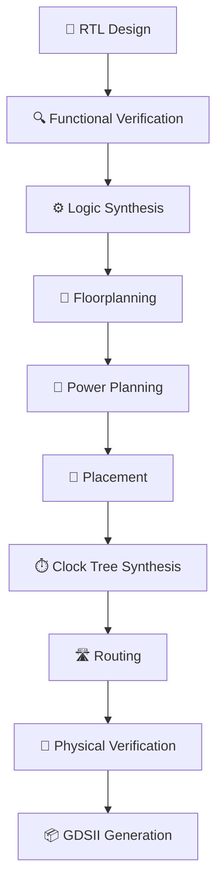
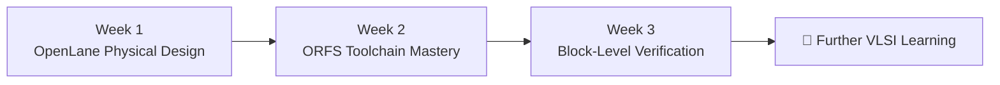

# 🚀 VSD Squadron RTL-to-GDSII Program

  
  
  
  

  <b>Physical Design Fundamentals • Open-Source EDA • RTL Workflows • Verification</b>

---

   <b></b>

## 📌 About This Repository

Welcome to my **VSD Squadron RTL-to-GDSII Program** repository.

This repository documents my hands-on learning journey in VLSI Physical Design, covering OpenLane Physical Design fundamentals, ORFS toolchain setup, RTL-to-GDSII workflows, and block-level verification.

The work is structured week-wise and phase-wise to provide an organized record of technical learning, practical activities, diagrams, evidence, and documentation.

This repository serves as a technical portfolio showcasing my exposure to open-source ASIC design workflows and VLSI implementation concepts.

---

## 🎯 Program Objectives

- Understand the RTL-to-GDSII implementation flow.
- Develop foundational knowledge of ASIC Physical Design.
- Explore OpenLane and OpenROAD-based workflows.
- Understand ORFS toolchain configuration and execution.
- Explore standalone and Caravel-based testing.
- Study block-level verification concepts.
- Develop Linux, Unix, Git, and documentation skills.
- Maintain a structured technical learning portfolio.

---

## 📅 Weekly Progress Tracker

| Week | Topic | Key Areas | Status |
|---|---|---|---|
| Week 1 | OpenLane Physical Design Workshop | Physical Design fundamentals, SKY130, RTL2GDS, PNR | ✅ Completed |
| Week 2 | Toolchain Mastery and ORFS — Cloud to Local | Cloud ORFS, toolchain setup, local installation, RTL2GDS run, Unix debugging | ✅ Completed |
| Week 3 | Block-Level Verification | Standalone verification, standalone tests, Caravel tests, verification flow, documentation | ✅ Completed |

---

## 📚 Weekly Documentation

<b>📘 Week 1 — OpenLane Physical Design Workshop</b>

**Focus:** Physical Design fundamentals and OpenLane workflow.

[➡️ View Week 1 README](<WEEK 1-openlane-workshop/README.md>)

<b>📘 Week 2 — Toolchain Mastery and ORFS</b>

**Focus:** ORFS execution, toolchain understanding, local setup, RTL-to-GDSII run, and Unix debugging.

[➡️ View Week 2 README](<WEEK 2/README.md>)

### Week 2 Phases

| Phase | Topic | Status |
|---|---|---|
| Phase 1 | Cloud ORFS | ✅ Completed |
| Phase 2 | Toolchain Understanding | ✅ Completed |
| Phase 3 | Local Installation | ✅ Completed |
| Phase 4 | Local RTL-to-GDSII Run | ✅ Completed |
| Phase 5 | Unix Debugging | ✅ Completed |

<b>📘 Week 3 — Block-Level Verification</b>

**Focus:** Standalone verification, standalone tests, Caravel tests, verification flow, and documentation.

[➡️ View Week 3 README](<WEEK 3/README.md>)

### Week 3 Phases

| Phase | Topic | Status |
|---|---|---|
| Phase 1 | Standalone Verification | ✅ Completed |
| Phase 2 | Standalone Tests | ✅ Completed |
| Phase 3 | Caravel Tests | ✅ Completed |
| Phase 4 | Verification Flow | ✅ Completed |
| Phase 5 | Documentation | ✅ Completed |

---

## 🔄 RTL-to-GDSII Implementation Flow

The RTL-to-GDSII process represents the transformation of a digital hardware design into a physical layout database.

### Major Design Stages

| Stage | Description |
|---|---|
| RTL Design | Describe digital hardware functionality |
| Functional Verification | Check design behavior |
| Logic Synthesis | Convert RTL into a gate-level netlist |
| Floorplanning | Define core area and design arrangement |
| Power Planning | Establish the power distribution network |
| Placement | Position standard cells |
| Clock Tree Synthesis | Build the clock distribution network |
| Routing | Connect design components |
| Physical Verification | Check layout correctness |
| GDSII Generation | Produce the physical layout database |

---

## 🛠️ Tools & Technologies

| Category | Tools / Technologies |
|---|---|
| Physical Design | OpenLane, OpenROAD |
| RTL-to-GDSII Flow | ORFS |
| Process Design Kit | SKY130 |
| Layout & Verification | Magic, Netgen |
| Circuit Design | Xschem, SPICE |
| Test Environment | Caravel |
| Operating System | Linux / Unix |
| Hardware Description | Verilog / RTL |
| Scripting | Tcl, Shell |
| Version Control | Git, GitHub |
| Documentation | Markdown, Mermaid |

---

## 📈 Skills & Technical Exposure

| Technical Knowledge | Practical Exposure |
|---|---|
| ASIC Physical Design fundamentals | Open-source EDA workflows |
| RTL-to-GDSII concepts | Toolchain configuration |
| OpenLane and ORFS | Linux command-line usage |
| Floorplanning and PNR concepts | Workflow execution |
| Block-Level Verification | Standalone and Caravel test organization |
| Physical Verification concepts | Technical documentation |
| Git and GitHub | Repository organization and version control |

---

## 📸 Documentation & Evidence

The repository maintains technical documentation and supporting evidence in the relevant weekly and phase-wise folders.

Documentation includes:

- 📖 Weekly README files
- 📂 Phase-wise README files
- 📊 Workflow diagrams
- 📷 Screenshots and execution evidence
- 💻 Supporting scripts
- 📈 Progress tables

This structure allows individual activities to be reviewed independently while preserving the overall program learning journey.

---

## 🏆 Learning Journey

---

## 👩‍💻 Author

  <b>Mysha Fathima</b> 
  B.E. — Electronics & Communication Engineering 
  Aspiring VLSI Physical Design Engineer

  

---

## 🙏 Acknowledgment

I would like to thank **VLSI System Design (VSD)** for providing the opportunity to learn and explore open-source ASIC design and VLSI Physical Design workflows through the VSD Squadron RTL-to-GDSII Program.

---

  <b>🔬 Learning • Implementing • Verifying • Documenting</b> 
  Building a strong foundation in VLSI Physical Design.

