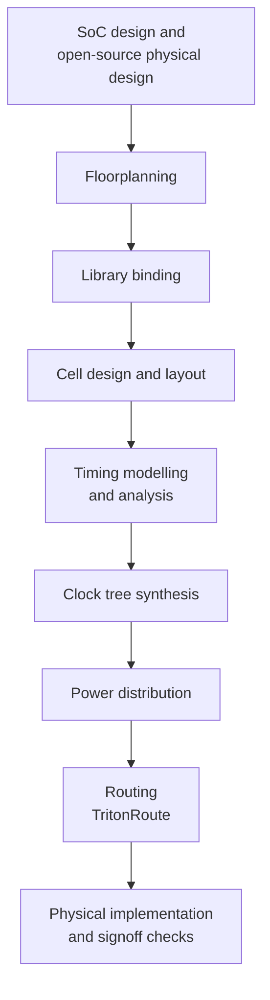

# Week 1: SKY130 Physical Design Workshop (OpenLane)
 
> **Hands-on ASIC physical design with the open-source SKY130 PDK.** The full lab work, scripts and screenshots live in a dedicated repository. This page is the summary and the index.
 

 
**Author:** Mysha Fathima ([@Mysha-Fathima](https://github.com/Mysha-Fathima))

**Program:** VSD Squadron, Week 1 (workshop by VLSI System Design, VSD)
 
---
 
## At a glance
 
| | |
|---|---|
| **Training** | VLSI System Design (VSD) |
| **Domain** | Physical design / ASIC backend |
| **PDK** | SKY130 open-source PDK (`sky130A`, cells: `sky130_fd_sc_hd`) |
| **Duration** | 10 days |
| **Flow** | RTL-to-GDSII with OpenLane (v1.0.2) |
| **Environment** | Linux |
| **Full work** | [PHYSICAL--DESIGN-SKY130-OpenLane-Workshop](https://github.com/Mysha-Fathima/PHYSICAL--DESIGN-SKY130-OpenLane-Workshop) |
 
---
 
## The flow covered in the workshop
 

 
---
 
## Modules and labs
 
The workshop has five modules. Each has a lab folder in the full repository.
 
| Module | Topic | Lab work completed | Lab folder |
|:---:|---|---|---|
| 1 | Inception of open-source ASIC design | OpenLane setup, design preparation, synthesis, cell-count and flop-ratio report | [Day02_M1_Lab_Inception](https://github.com/Mysha-Fathima/PHYSICAL--DESIGN-SKY130-OpenLane-Workshop/tree/main/Day02_M1_Lab_Inception) |
| 2 | Good vs bad floorplan, placement | Floorplan (die and core area, IO placement, PDN), global and detailed placement | [Day04_M2_Lab_Floorplanning](https://github.com/Mysha-Fathima/PHYSICAL--DESIGN-SKY130-OpenLane-Workshop/tree/main/Day04_M2_Lab_Floorplanning) |
| 3 | Design library cells (Magic, ngspice) | CMOS inverter layout, SPICE extraction, ngspice simulations, Magic DRC | [Day06_M3_Lab_LibraryCell](https://github.com/Mysha-Fathima/PHYSICAL--DESIGN-SKY130-OpenLane-Workshop/tree/main/Day06_M3_Lab_LibraryCell) |
| 4 | Pre-layout timing and CTS | Clock tree synthesis, post-CTS setup and hold analysis, clock skew | [Day08_M4_Lab_Timing](https://github.com/Mysha-Fathima/PHYSICAL--DESIGN-SKY130-OpenLane-Workshop/tree/main/Day08_M4_Lab_Timing) |
| 5 | Final steps: routing and signoff | Power distribution, global and detailed routing, Magic GDS and DRC, antenna check | [Day10_M5_Lab_Routing](https://github.com/Mysha-Fathima/PHYSICAL--DESIGN-SKY130-OpenLane-Workshop/tree/main/Day10_M5_Lab_Routing) |
 
---
 
## Syllabus
 
| Day | Theme | Topics |
|:---:|---|---|
| 1 | Inception of open-source physical design | How to approach SoC design, open-source physical design concepts, getting familiar with the environment |
| 2 | Good floorplan vs bad floorplan | Chip floorplanning, library binding, cell design and characterisation, general timing concepts |
| 3 | Design library cells | CMOS inverter and library-cell labs, introduction to layout, SKY130 technology file |
| 4 | Pre-layout timing analysis | Timing modelling, timing analysis, clock tree synthesis, implementation considerations |
| 5 | Final steps for RTL-to-GDSII | Routing and design implementation, power distribution, TritonRoute features |
 
---
 
## Tools and technologies
 
| Category | Technology |
|---|---|
| PDK | SKY130 |
| Flow | OpenLane v1.0.2 (RTL-to-GDSII) |
| Layout and checks | Magic (layout, DRC, GDS) |
| Simulation | ngspice (SPICE) |
| Routing | TritonRoute |
| Operating system | Linux |
| Version control | Git and GitHub |
 
---
 
## Status
 
| Area | Status |
|---|:---:|
| Module 1: synthesis and reports | ✅ |
| Module 2: floorplan and placement | ✅ |
| Module 3: library cell layout, extraction, simulation, DRC | ✅ |
| Module 4: CTS and post-CTS timing | ✅ |
| Module 5: power distribution, routing, GDS, antenna check | ✅ |

**Reproducibility:** the design inputs are in `design/` and the exact command sequence is in `flow/flow_commands.tcl` in the full repository.
 
---
 
## Skills developed
 
`Physical design` · `ASIC backend` · `SKY130` · `Floorplanning` · `Library binding` · `Standard cells` · `CMOS layout` · `Timing analysis` · `CTS` · `Power distribution` · `Routing` · `TritonRoute` · `RTL-to-GDSII` · `Linux` · `Git and GitHub`
 
---
 
## How Week 1 connects to Week 2
 
| | Week 1 | Week 2 |
|---|---|---|
| Flow tool | OpenLane | OpenROAD Flow Scripts (ORFS) |
| Focus | Concepts and labs for each stage | Running the whole flow, understanding the toolchain |
| Where | Ready-made environment | Codespace first, then a machine set up by me |
| PDK | SKY130 | SKY130 (`sky130hd`) |
 
Week 1 explained what each stage of the flow does. [Week 2](https://github.com/Mysha-Fathima/VSD-SQUADRON-RTL2GDSII/blob/4ffaa863be4d25ffd2e9ba8a40b723e1072acfd4/WEEK%202/README.md) repeats the same journey with ORFS and traces which tool does each step.
 
---
 
## Career focus
 

 
---
 
[Back to the main repository](../README.md)