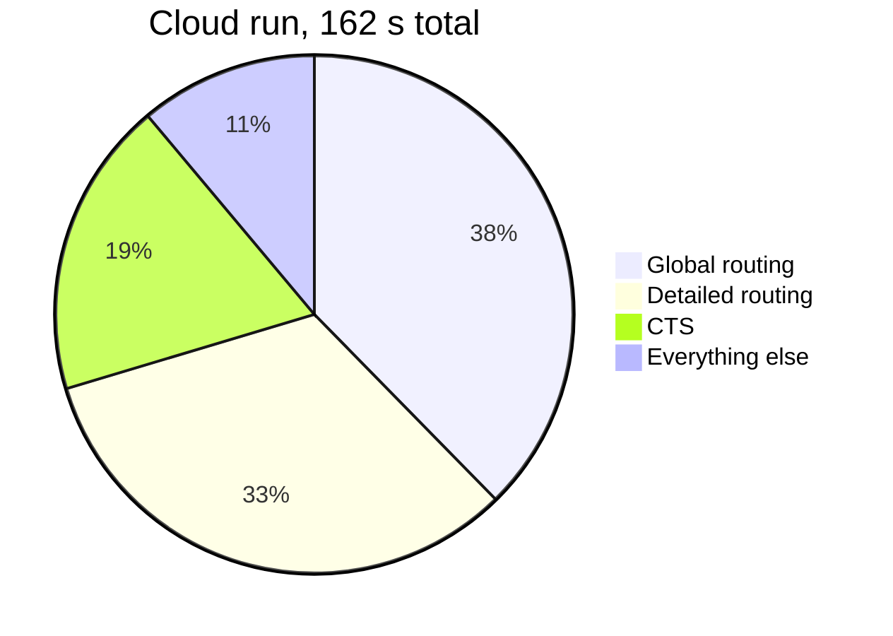

# Phase 4: RTL-to-GDS Locally
 
**Goal:** re-run the exact same testcase from Phase 1 on my local setup (Phase 3) and compare the results with the cloud run.
 
| | |
|---|---|
| **Design** | `gcd` on `sky130hd` (same as Phase 1) |
| **Environment** | Local Ubuntu 24.04 environment from Phase 3 (4 cores, 15 GB RAM) |
| **Result** | All 19 stages completed, GDS generated, total time **1m 48s** |
 
---
 
## 1. Setting up the run
 
The Dockerfile sets environment variables that tell ORFS where the tools are. I set the same ones locally:
 
```bash
export OPENROAD_EXE=/usr/local/bin/openroad
export YOSYS_EXE=/opt/oss-cad-suite/bin/yosys
export YOSYS_PLUGIN_PATH=/opt/oss-cad-suite/share/yosys/plugins
```
 
Then I ran the **same command** as in the cloud:
 
```bash
cd orfs/flow
time make DESIGN_CONFIG=./designs/sky130hd/gcd/config.mk 2>&1 | tee ~/evidence_local/week2_local_run.log
```
 
> 📸 **Screenshot:** the environment variables and the `make` command
> 
> 

 
---
 
## 2. Required proof
 
| # | Proof required | Saved file |
|---|---|---|
| 1 | Synthesis completion | [1_synthesis.txt](evidence/1_synthesis.txt) |
| 2 | Floorplan snippet | [2_floorplan.txt](evidence/2_floorplan.txt) |
| 3 | Placement proof | [3_placement.txt](evidence/3_placement.txt) |
| 4 | CTS log snippet | [4_cts.txt](evidence/4_cts.txt) |
| 5 | Routing proof | [5_routing.txt](evidence/5_routing.txt) |
| 6 | Final GDS generated locally | [6_gds.txt](evidence/6_gds.txt) |
| 7 | Timing report (WNS/TNS) | [7_timing.txt](evidence/7_timing.txt) |
 
Full run log: [week2_local_run.log](evidence/week2_local_run.log)
 
> 📸 **Screenshot:** end of the local run (stage table and `real 1m48s`)
>

> 📸 **Screenshot:** synthesis proof
>

> 📸 **Screenshot:** placement proof
>

> 📸 **Screenshot:** CTS log snippet
>

> 📸 **Screenshot:** routing proof
>

> 📸 **Screenshot:** `ls -lh .../6_final.gds` (821 KB)
>

> 📸 **Screenshot:** `cat 7_timing.txt` (WNS -2.19, TNS -92.21)
> 

---
 
## 3. Cloud vs local comparison
 
### Results
 
| Metric | Cloud (Phase 1) | Local (Phase 4) | Same? |
|---|---|---|:---:|
| Runtime (`real`) | 3m 15.5s | 1m 48.5s | no |
| CPU time (`user`) | 3m 18.7s | 3m 3.5s | close |
| Total flow time (stage table) | 162 s | 82 s | no |
| Peak memory | 635 MB | 698 MB | close |
| **WNS** | **-2.19** | **-2.19** | ✅ |
| **TNS** | **-92.21** | **-92.21** | ✅ |
| GDS generated | Yes, 821 KB | Yes, 821 KB | ✅ |
| Stages completed | 19 | 19 | ✅ |
 
### Environment differences
 
| | Cloud | Local |
|---|---|---|
| OS | Ubuntu 22.04 | Ubuntu 24.04 |
| OpenROAD | `v2.0-28075-g0f99689f45` | `v2.0-28075-g0f99689f45` |
| Yosys | `0.58+94` | `0.58+94` |
| KLayout | `0.30.9` | `0.28.16` |
| Python | 3.10.12 | 3.14.2 (Codespace's own) |
 
### Time per stage (seconds)
 
| Stage | Cloud | Local |
|---|---:|---:|
| Synthesis (`1_2_yosys` + `1_synth`) | 2 | 2 |
| Floorplan (`2_1` to `2_4`) | 3 | 1 |
| Placement (`3_1` to `3_5`) | 4 | 1 |
| CTS (`4_1_cts`) | 30 | 13 |
| Global routing (`5_1_grt`) | 61 | 33 |
| Detailed routing (`5_2_route`) | 53 | 29 |
| GDS merge (`6_1_merge`) | 4 | 1 |
| Report (`6_report`) | 3 | 2 |
| **Total** | **162** | **82** |
 
Where the cloud run spent its time:
 

 
### What the comparison shows
 
1. **The results are identical.** WNS, TNS and the GDS size match exactly, even though the OS and KLayout version differ.
2. **The local run was faster.** The CPU time (`user`) is almost the same in both runs, but the local wall-clock time is much shorter. That means the same amount of work was spread over more cores. The local Codespace had 4 cores. I did not check the core count of the cloud one, so I can only say it is likely smaller.
3. **Timing still fails in both runs** (WNS -2.19). Running somewhere else did not change the design quality, which confirms the flow is repeatable.
---
 
## 4. Reproducibility check with checksums
 
The stage table prints a column called `sha1sum .odb [0:20]` after each stage. It is a short **fingerprint** of the design database written by that stage. If even one tiny detail in the database changed, its fingerprint would be completely different.
 
I compared the two stage tables. The fingerprints are **the same in the cloud and local runs for every stage that prints one**, for example:
 
| Stage | Fingerprint (cloud and local) |
|---|---|
| `1_1_yosys_canonicalize` | `4ab3e4e34a3ee598705b` |
| `1_synth` | `402962fdf2f28a04e052` |
| `2_1_floorplan` | `e9a660012d47db85e270` |
| `3_3_place_gp` | `eea51883fd776b8e4bf3` |
| `4_1_cts` | `b01dd00ab57118c8ed22` |
| `5_2_route` | `6a0de006e10e501f0f21` |
 
So both machines produced the **same data at every step**, not just the same final numbers. (`6_1_merge` and `6_report` show `N/A` because they do not write a database.)
 
---
 
## 5. Errors and observations
 
| Item | Detail |
|---|---|
| Blocking errors | None in this run |
| Setup issue (earlier, Phase 3) | Prebuilt OpenROAD needed extra libraries on Ubuntu 24.04. Fixed before this run |
| Note | The Makefile prints `No elapsed time found in .../4_equivalence_check.log`. The flow continued normally, so I treated it as an informational message |
 
---
 
## 6. Checklist
 
- [x] Same testcase as Phase 1 (`gcd`, `sky130hd`)
- [x] Same `make` command
- [x] Synthesis completion proof
- [x] Placement proof
- [x] CTS log snippet
- [x] Routing proof
- [x] Final GDS generated locally
- [x] Timing report (WNS/TNS)
- [x] Cloud vs local comparison table
## 7. What I learned
 
- The same tools give the same results on a different machine, and checksums are a quick way to prove it.
- Runtime depends on the machine (cores), but results do not.
- A comparison table with both environment and result columns makes it easy to explain any difference.
  
## Key takeaway

A successful local re-run demonstrates that the implementation flow is not dependent only on the cloud container. The comparison also helps reveal whether differences come from the environment, configuration, tool versions, or the run itself.
