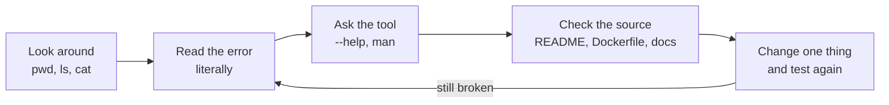
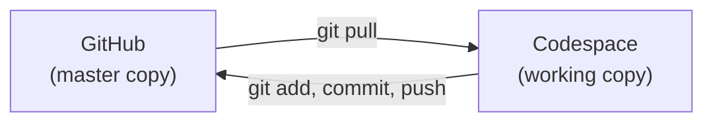

# Phase 5: Debugging and Unix Literacy
 
**Goal:** It shows that I can work comfortably in a Linux terminal: find files, read logs, search for problems, set variables, inspect a Makefile, and fix errors myself.
 
---
 
## 1. How I approach a problem
 

 
---
 
## 2. Commands I used and why
 
### Moving around and looking
 
| Command | What it does | Where I used it |
|---|---|---|
| `pwd` | Shows the current folder | Checking I was in `orfs/flow` before running `make` |
| `ls`, `ls -a`, `ls -l`, `ls -ltr`, `ls -lh` | Lists files (hidden, detailed, newest last, human-readable sizes) | Finding the hidden `.devcontainer` folder and checking `6_final.gds` size |
| `cd` | Changes folder | Moving between the repo, `orfs/flow` and `/tmp` |
| `cat file` | Prints a whole file | Reading `config.mk`, the Dockerfile, `devcontainer.json` |
| `head -N` / `tail -N` | First / last N lines | Logs are long, and the result is usually at the end |
| `sed -n '36,46p' file` | Prints only lines 36 to 46 | Reading just the Yosys block of the Dockerfile |
 
### Searching
 
| Command | What it does | Where I used it |
|---|---|---|
| `find . -name "*.gds"` | Searches for files by name | Locating every GDS file in the repo |
| `grep -i violated file` | Prints matching lines, ignoring case | Finding timing violations in `6_finish.rpt` |
| `grep -iE "wns\|tns\|slack"` | `-E` allows "or" between words | Pulling the timing numbers out of a long report |
| `grep -n`, `grep -c`, `grep -m3` | Show line numbers / count matches / stop after 3 | Dockerfile lines and build-log warning counts |
| `\|` (pipe) | Sends one command's output into the next | `find ... \| grep sky130`, `... \| head` |
 
### Running and recording
 
| Command | What it does | Where I used it |
|---|---|---|
| `time make ...` | Measures how long a command takes | Runtime of the cloud and local flows |
| `2>&1 \| tee file` | Shows output and saves it, including errors | Run logs and the install log |
| `>` and `>>` | Write to a file / append to a file | Saving evidence snippets |
| `nohup ... &` | Runs a long job in the background | The OpenROAD source build |
| `export B=sky130hd/gcd/base` and `echo $B` | Sets a variable and prints it | Short paths for the log folders |
| `which`, `ldd` | Find where a tool lives / list libraries a program needs | Tool paths and the missing-library fix |
| `df -h`, `free -h`, `nproc` | Disk space, memory, CPU cores | Checking the machine before a big build |
 
### Installing and copying
 
| Command | What it does | Where I used it |
|---|---|---|
| `sudo apt-get install` | Installs system packages | Build tools, KLayout, missing libraries |
| `curl -L -o file URL`, `tar -xzf`, `dpkg -x` | Download, unpack archive, unpack a `.deb` | Yosys archive and the old libraries |
| `cp`, `mkdir -p` | Copy files / make folders | Collecting evidence |
| `ldconfig` | Refreshes the system's library list | After adding libraries |
 
### Git
 
| Command | What it does |
|---|---|
| `git clone`, `git pull` | Download a repo / fetch the latest changes |
| `git status`, `git log --oneline` | See what changed / see history |
| `git add -A`, `git commit -m`, `git push` | Save changes locally / send them to GitHub |
| `git mv` | Rename a file or folder and track it |
 
> 📸 **Screenshot:** `export B=...`, `echo $B`, `grep -i violated ...`, `find . -name "*.gds"`, `ls designs/sky130hd/gcd`
>
>

> 📸 **Screenshot:** `head -40 Makefile` (Makefile inspection)
>

> 📸 **Screenshot:** `grep -nE "1_synth|2_1_floorplan|4_1_cts|5_2_route|6_final" Makefile`
>
>
 
---
 
## 3. Reading logs for timing problems
 
```bash
grep -i violated reports/sky130hd/gcd/base/6_finish.rpt
grep -iE "wns|tns|slack" reports/sky130hd/gcd/base/6_finish.rpt
```
 
Result: `wns max -2.19`, `tns max -92.21`, and a path reported as `slack (VIOLATED)`. This is how I confirmed the design did not meet timing, without opening the whole report.
 
---
 
## 4. Problems I debugged
 
| # | Symptom | Cause | Fix | Lesson |
|---|---|---|---|---|
| 1 | `bash: less: command not found` | The Codespace image does not include `less` | Used `head -40 Makefile` instead (or `sudo apt-get install -y less`) | If a tool is missing, use another tool or install it |
| 2 | `openroad: error while loading shared libraries: libtclreadline-2.3.8.so` | Prebuilt binary built for Ubuntu 22.04, machine runs 24.04. Four libraries missing | `apt-get` for two, old `.deb` files unpacked with `dpkg -x` into `/opt/openroad/lib` for the other two, then `ldconfig` | `ldd program \| grep "not found"` lists exactly what is missing |
| 3 | `sed: can't read .devcontainer/Dockerfile: No such file` | Ran the command from the wrong folder | `cd` to the repo root, then ran it again | Check `pwd` first |
| 4 | New folders made on github.com were missing in the Codespace | Two separate copies of the repo. The Codespace did not have the website's changes | `git pull` | Start with `git pull`, finish with `git push` |
| 5 | Folder names with `:` (for example `PHASE1:ORFS Execution`) | Windows cannot create folders with a colon, so cloning to a PC would fail | Renamed with `git mv` (`:` to `-`) | Avoid special characters in file and folder names |
| 6 | `python3` showed 3.14.2, not 3.10.12 | The Codespace puts its own Python first in `PATH` | Noted it. `/usr/bin/python3` is the system one | `which` shows which program actually runs |
 
> 📸 **Screenshot:** the `less: command not found` error
>
>

> 📸 **Screenshot:** the shared-library error and its fix (`ldd` before and after)
<<<<<<< HEAD


> 📸 **Screenshot:** the failed `sed` command and the corrected one
=======
>
>

> 📸 **Screenshot:** the failed `sed` command and the corrected one
> 
>>>>>>> 8c9920e1823d6b92ea96f773d80c8a7ecdc790b0

 
---
 
## 5. Working with Git and Codespaces
 

 
- Edits made in the Codespace exist only there until I commit and push.
- Edits made on github.com exist only on GitHub until I run `git pull` in the Codespace.
- Rule I follow: **pull before I start, push before I stop.**
---
 
## 6. Checklist
 
- [x] Navigated folders and listed files (`pwd`, `ls`, `cd`)
- [x] Read configs and logs (`cat`, `head`, `tail`, `sed`)
- [x] Searched files and reports (`find`, `grep`)
- [x] Filtered timing violations from a report
- [x] Inspected a Makefile
- [x] Set and used an environment variable (`export`, `echo`)
- [x] Saved command output to files (`>`, `tee`)
- [x] Fixed at least one real error (missing shared libraries)
- [x] Used Git from the terminal (`pull`, `commit`, `push`, `mv`)
## 7. What I learned
 
- Most terminal work is the same few commands in different combinations.
- The error message usually tells you what is missing. Read it word by word.
- Check where you are (`pwd`) and what is on your `PATH` (`which`) before assuming a tool is broken.
