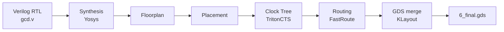

# Week 2: Toolchain Mastery and ORFS Execution (Cloud to Local)
 
> **Focus:** Build independent RTL-to-GDSII execution skills using OpenROAD Flow Scripts (ORFS), first in GitHub Codespaces and then in a local Linux-based environment.
 
**Author:** Mysha Fathima ([@Mysha-Fathima](https://github.com/Mysha-Fathima))
**Course:** VSD Squadron RTL-to-GDSII program, Week 2
**Dates:** 26 to 29 October 2026
**Report (Google Doc):** [ADD LINK HERE]
 
---
 
## Progress
 
| Phase | Topic | Status |
|---|---|:---:|
| [Phase 1](<PHASE1-ORFS Execution/README.md>) | ORFS execution in the cloud (Codespaces) | ✅ |
| [Phase 2](<PHASE2-Toolchain Understanding/README.md>) | Toolchain understanding | ✅ |
| [Phase 3](<Phase3- Local Installation/README.md>) | Local installation (ORFS and official OpenROAD build) | ✅ |
| [Phase 4](<Phase4- RTL-to-GDS Locally/README.md>) | RTL-to-GDS re-run locally and comparison | ✅ |
| [Phase 5](<Phase5- Debugging and Unix Literacy/README.md>) | Debugging and Unix literacy | ✅ |
 
---
## Repository and references

- Workshop repository: [vsd-scl180-orfs](https://github.com/vsdip/vsd-scl180-orfs)
- Week 6 target project: [vsdsquadron-soc](https://github.com/vsdip/vsdsquadron-soc) 

## Tools and versions
 
| Tool | Version | Role |
|---|---|---|
| OpenROAD | `v2.0-28075-g0f99689f45` | Floorplan, placement, CTS, routing, timing |
| OpenROAD (built from source) | commit `7c83752` | Official Bazel build, verified in Phase 3 |
| Yosys | `0.58+94` | Synthesis |
| KLayout | `0.30.9` (cloud), `0.28.16` (local) | GDS merge |
| Make | `4.3` | Runs the flow |
| Python | `3.10.12` (cloud), `3.14.2` (local) | Helper scripts |
 
---
  
## The flow I ran
 

 
Design: `gcd` on `sky130hd`, driven by a single `make` command in `orfs/flow`.
 
---
## Phase documentation

| Phase | README | What it documents | what it delivered |
|---|---|---|---|
| 1 | [Phase 1 — ORFS Cloud Run](phase-1-orfs-cloud/README.md) | Codespaces setup, tool versions, cloud flow and results | forked the ORFS repo, ran the Sky130 `gcd` flow in a Codespace, and collected proof for synthesis, floorplan, placement, CTS, routing, GDS and timing.|
| 2 | [Phase 2 — Toolchain Understanding](phase-2-toolchain/README.md) | Tool purposes, installation sources and flow architecture | traced where every tool comes from (Dockerfile, install script, built into OpenROAD), built the toolchain table, and explained how the flow is chained by the Makefile. |
| 3 | [Phase 3 — Local Installation](phase-3-local-installation/README.md) | Local ORFS and official OpenROAD installation | set up a clean Ubuntu 24.04 machine, installed ORFS, Yosys, KLayout and OpenROAD myself, fixed a missing-library problem, and built the official OpenROAD from source with Bazel. |
| 4 | [Phase 4 — Local RTL-to-GDS](phase-4-local-rtl-to-gds/README.md) | Local execution and cloud/local comparison | repeated the same run locally, compared cloud and local results, and checked reproducibility with per-stage checksums. |
| 5 | [Phase 5 — Unix & Debugging](phase-5-unix-debugging/README.md) | Commands, log inspection and debugging evidence | practised Linux commands for searching logs and reports, inspected the Makefile, and documented the problems I debugged. |
---
## Linux commands
## 1. Navigation and Looking Around

| Command | What it does | Why we used it |
| :--- | :--- | :--- |
| `pwd` | Prints the current working directory path | To verify your exact location (note: `make` must be run from `orfs/flow`). |
| `ls` | Lists files and folders | To see the contents of the current directory. |
| `ls -ltr` | Long format (`-l`), sorted by time (`-t`), reversed order (`-r`) | To see creation dates (newest files appear last). Helps identify if the repo came from a clone. |
| `ls -lh <file>` | Human-readable (`-h`) file details | To confirm a specific file exists and view its exact size (e.g., checking if `6_final.gds` is `821K`). |
| `cd orfs/flow` | Changes the directory | To navigate into the specific directory where the `Makefile` lives. |

---

## 2. Finding and Reading Files

| Command | What it does | Why we used it |
| :--- | :--- | :--- |
| `find . -name Makefile` | Searches from the current folder (`.`) for a specific file by name | To locate the `Makefile` and `config.mk` without guessing their exact directory paths. |
| `\|` (pipe) | Sends the output of one command as the input to the next | Combines commands (e.g., `find ... \| grep sky130` filters find results). |
| `grep -i sky130` | Prints lines matching text; case-insensitive (`-i`) | To filter search results and keep only entries containing "Sky130". |
| `grep -iE "wns\|tns\|slack"` | Extended regex (`-E`) allowing logical OR (`\|`) | To isolate specific timing metrics out of a massive text report. |
| `cat <file>` | Prints the entire contents of a file to the screen | To quickly read short files like `config.mk`. |
| `head -20` / `tail -25` | Outputs the first / last `N` lines of a file | To inspect long logs where the most relevant data is at the beginning or the end. |
| `less Makefile` | Opens a file in a scrollable viewer | To read long files page-by-page. Press `q` to exit. |

---

## 3. Running the Flow

| Command | What it does | Why we used it |
| :--- | :--- | :--- |
| `make clean_all` | Deletes old results, logs, and generated reports | To clear past data so your next run starts fresh and captures only your results. |
| `make DESIGN_CONFIG=...` | Executes the flow using the specified configuration | Reads the `Makefile` rules to process tool inputs and outputs in correct order. |
| `time make ...` | Tracks the execution time of the command | Provides precise benchmark data (e.g., `3m15s`) for local vs. cloud performance tables. |
| `2>&1` | Merges error messages (Stream 2) into standard output (Stream 1) | Ensures that any tool warnings or errors are captured in your logged output. |
| `tee <file>` | Prints output to the terminal screen while saving it to a file | Allows you to monitor execution progress live while saving a permanent log file. |

---

## 4. Shortcuts and Saving Evidence

| Command | What it does | Why we used it |
| :--- | :--- | :--- |
| `B=sky130hd/gcd/base` | Defines a shortcut environment variable | Speeds up execution by using `$B` instead of typing out long paths repeatedly. |
| `mkdir -p ~/evidence` | Creates a folder; `-p` ignores errors if it already exists | Sets up a dedicated repository in your home directory (`~`) to store flow proof. |
| `>` | Redirects command output to a file (overwrites existing file contents) | To save specific terminal outputs into a new file (e.g., `tail ... > 1_synthesis.txt`). |
| `>>` | Appends command output to the end of a file | Adds new information to a file without erasing what was already written. |
| `cp <a> <b>` / `cp -r <dir> <dest>` | Copies files or folders (`-r` recursively copies sub-directories) | Extracts evidence out of the tool directories and brings it to your workspace. |

---

## 5. Version Checks

These validation commands confirm the exact binaries used during the run. Tool versions impact structural outputs and are critical when running comparative cloud vs. local tests:

* **OpenROAD version:** `openroad -version`
* **Yosys version:** `yosys -V`
* **Python version:** `python3 --version`
* **Make version:** `make --version`
* **Locate path:** `which openroad` *(Shows exactly where the executable binary resides on the system environment path)*
---

## What Week 2 covers

### 1. Cloud execution
Set up the repository in GitHub Codespaces, wait for the devcontainer to finish building, verify the installed tools, and run the provided testcase through the complete RTL-to-GDS flow.

### 2. Toolchain understanding
Read `.devcontainer/Dockerfile` and `.devcontainer/install-openroad.sh`. Record which tools are installed, where each tool comes from, what it does, and where it is used in the flow.

### 3. Local environment
Recreate the environment on a computer you control. Install the workshop ORFS setup and the official OpenROAD tool, then record successful version checks and any installation issues.

### 4. Cloud-versus-local comparison
Run the exact same testcase locally. Compare runtime, WNS, TNS, and whether the GDS output was generated. Explain any differences instead of assuming the results should be identical.

### 5. Unix and debugging skills
Practise navigating folders, inspecting scripts, searching logs, filtering timing violations, and checking environment variables with commands such as `ls`, `cd`, `pwd`, `grep`, `find`, `cat`, `less`, `echo`, and `export`.

## Results at a glance
 
| | Cloud (Phase 1) | Local (Phase 4) |
|---|---|---|
| Runtime | 3m 15s | 1m 48s |
| Stages completed | 19 of 19 | 19 of 19 |
| WNS | -2.19 | -2.19 |
| TNS | -92.21 | -92.21 |
| Final GDS | 821 KB | 821 KB |
| Stage checksums | | identical to cloud |
 
Identical timing numbers, GDS size and checksums on two different machines show that the flow is **repeatable**. The design itself does not meet timing (negative slack), which I recorded as it is.
  
## Folder structure
 
```text
WEEK 2/
├── README.md                              <- this file
├── PHASE1-OpenROAD/                        cloud run evidence
├── PHASE2-Toolchain Understanding/        toolchain table and flow explanation
├── Phase3- Local Installation/            install log, build log, versions
├── Phase4- RTL-to-GDS Locally/            local run evidence and comparison
└── Phase5- Debugging and Unix Literacy/   commands and debugging log
```
 
---
 
## Key takeaways
 
- ORFS turns RTL into GDS with one command, and each stage leaves its own log as proof.
- OpenROAD is one binary containing several tools (TritonCTS, FastRoute, OpenSTA).
- A prebuilt tool can fail on a different OS version. `ldd` shows what is missing, and the error message names the first problem.
- A finished flow is not a timing-clean design: WNS and TNS must always be read.
- The same flow gives the same results on a different machine, and checksums can prove it.
- Git has two copies of everything (GitHub and the working copy), so pull before starting and push before stopping.
---
 
## Next: Week 3
 
Week 3 builds on this setup. The Codespace environment, OpenROAD and ORFS are ready to reuse.
 

## Completion statement

When every required phase and evidence item is complete, this repository will demonstrate that I can run the workshop RTL-to-GDS testcase in both cloud and local environments, explain the supporting toolchain, and investigate basic execution or timing issues independently.


