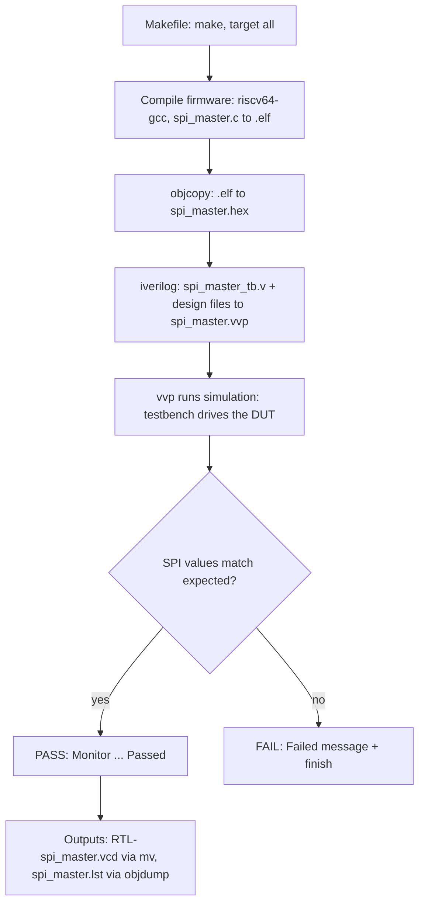
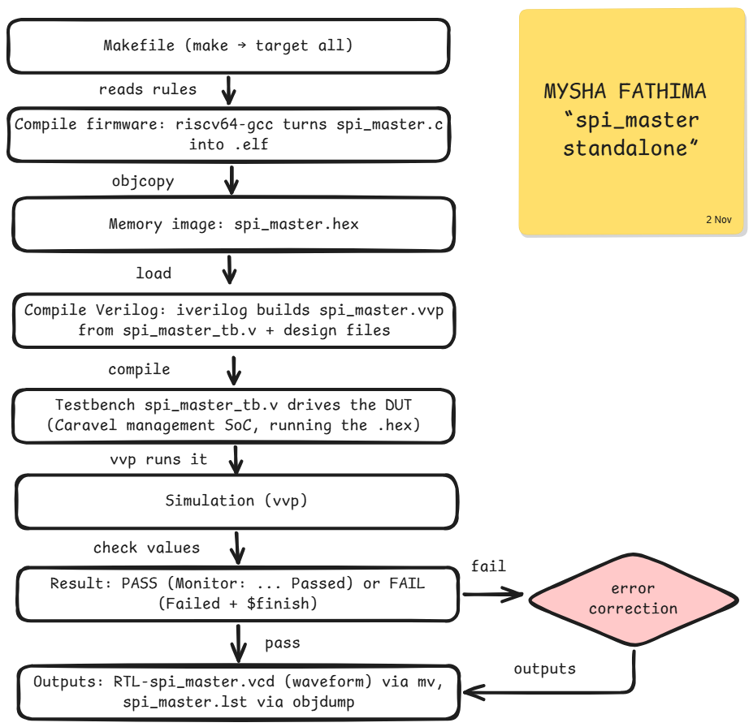

<div align="center">

# 🧪 Week 3 · Phase 1 — Standalone Block Verification

**Block under test: `spi_master` · VSDSquadron SoC (Caravel management SoC)**


*Author: Mysha Fathima · Date: 2 November 2026*

</div>

---

## 📑 Contents

| # | Section |
|---|---|
| 1 | [Objective](#1--objective) |
| 2 | [Environment](#2--environment) |
| 3 | [Task 1 — Run SPI Master Test](#3--task-1--run-spi-master-test) |
| 4 | [Task 2 — Understand the Verification Flow](#4--task-2--understand-the-verification-flow) |
| 5 | [Issues Faced and Fixes](#5--issues-faced-and-fixes) |
| 6 | [Commands Used](#6--commands-used) |
| 7 | [Evidence Files](#7--evidence-files) |
| 8 | [Conclusion](#8--conclusion) |

---

## 1 · 📌 Objective

Run the standalone `spi_master` test of the VSDSquadron SoC, decide whether it passes or fails (**Task 1**), and understand how the Makefile builds and runs the verification, including how PASS or FAIL is decided (**Task 2**).

## 2 · 🖥️ Environment

| Item | Value |
|---|---|
| Platform | GitHub Codespaces, Ubuntu 24.04 |
| Repository | [vsdip/vsdsquadron-soc](https://github.com/vsdip/vsdsquadron-soc), branch `add-vsdsquadron-soc-folders` |
| Test location | `caravel_mgmt_soc_litex/verilog/dv/tests-standalone/spi_master` |
| Simulator | Icarus Verilog (`iverilog` compiles, `vvp` runs) |
| Firmware compiler | `riscv64-unknown-elf-gcc` 13.2.0 (installed with `apt`) |
| Target CPU | VexRiscv, `-march=rv32i_zicsr`, `-mabi=ilp32` |
| Simulation type | RTL (`SIM=RTL`, `CONFIG=standalone`) |

---

## 3 · ▶️ Task 1 — Run SPI Master Test

### 3.1 Steps

| Step | Command | Why |
|---|---|---|
| 1 | `git clone --depth 1 -b add-vsdsquadron-soc-folders https://github.com/vsdip/vsdsquadron-soc` | Download the SoC repo (latest snapshot only, saves disk) |
| 2 | `cd .../verilog/dv/tests-standalone/spi_master` | Enter the test folder |
| 3 | `source /workspaces/week3_env.sh` | Load path settings (see Issues, fix 2) |
| 4 | `make clean` | Delete old build files for a fresh start |
| 5 | `make CPUFLAGS_vexriscv="-march=rv32i_zicsr -mabi=ilp32 -D__vexriscv__"` | Build and simulate (the flag is explained in Issues, fix 3) |

### 3.2 Observation

The simulation compares each SPI value read back with its expected value:

| Check | Expected SPI value | Observed |
|---|---|---|
| 1 | `0x02` | ✅ matched |
| 2 | `0x63` | ✅ matched |
| 3 | `0x57` | ✅ matched |
| 4 | `0xb5` | ✅ matched |
| 5 | `0x00` | ✅ matched |
| 6 | `0x23` | ✅ matched |
| 7 | `0x20` | ✅ matched |

### 3.3 Result

| Test (tests-standalone) | Status (sky130) |
|---|---|
| spi_master | ✅ **PASS** |

Verdict line from the testbench: `Monitor: Test SPI Master (RTL) Passed`

**📸 Screenshot 1.1 — `make` ends with PASS**


<br><br><br>

**📸 Screenshot 1.2 — SPI values matching (middle of the log)**


<br><br><br>

---

## 4 · 🔄 Task 2 — Understand the Verification Flow

### 4.1 What happens when `make` is executed

| Order | Stage | Tool | Input → Output |
|---|---|---|---|
| 1 | Read rules | `make` | `Makefile`, default target `all` (needs `.vcd` and `.lst`) |
| 2 | Prepare | `prepare-generated`, `check-fw` | creates `generated/` and the linker file `regions.ld` |
| 3 | Compile firmware | `riscv64-unknown-elf-gcc` | `spi_master.c` + `start_caravel_vexriscv.s` → `spi_master.elf` |
| 4 | Make memory image | `objcopy -O verilog` | `spi_master.elf` → `spi_master.hex` |
| 5 | Compile Verilog | `iverilog` | `spi_master_tb.v` + design files → `spi_master.vvp` |
| 6 | Simulate | `vvp` | `spi_master.vvp` → console messages + `spi_master.vcd` |
| 7 | Save outputs | `mv`, `objdump` | `RTL-spi_master.vcd` (waveform), `spi_master.lst` (disassembly) |

### 4.2 Makefile rules

| Rule (line) | Needs | What it does |
|---|---|---|
| `all` (65) | `.vcd`, `.lst` | Default target, builds everything |
| `hex` (66) | `.hex` | Builds only the hex file |
| `prepare-generated` (78) | none | Creates the `generated/` folder |
| `check-fw` (90) | `prepare-generated` | Checks the linker script is set |
| `%.elf` (97) | `%.c`, `check-fw` | Compiles the C firmware |
| `%.lst` (110) | `%.elf` | `objdump` listing |
| `%.hex` (113) | `%.elf` | `objcopy -O verilog` memory image |
| `%.bin` (118) | `%.elf` | `objcopy -O binary` image |
| `%.vvp` (125) | `%_tb.v`, `%.hex` | `iverilog` compile |
| `%.vcd` (171) | `%.vvp` | `vvp` run, then `mv` the waveform |
| `clean` (184) | none | Deletes `.elf .hex .bin .vvp .log .vcd .lst` |

**📸 Screenshot 2.1 — Makefile rule list (`grep -n` output)**


<br><br><br>

### 4.3 Makefile symbols

| Symbol | Meaning |
|---|---|
| `%` | Wildcard for the test name, so one rule serves every test |
| `$<` | First input of the rule |
| `$@` | Output file of the rule |
| `?=` | Set a variable only if it is not already set (lets us override paths) |
| `:=` | Set a variable once, immediately |
| `export` | Pass the variable on to the commands the Makefile runs |
| `ifeq` | Choose commands by setting (`SIM=RTL`, `GL`, `GL_SDF`) |

### 4.4 How the Makefile invokes the simulator

For `SIM=RTL` and `CONFIG=standalone`, the `%.vvp` rule runs:

```
iverilog -Ttyp -DFUNCTIONAL -DSIM -DUNIT_DELAY=#1 \
   -y /home/vsduser/caravel/verilog/rtl -I /home/vsduser/caravel/verilog/rtl \
   -f $(VERILOG_PATH)/includes/includes.rtl.standalone \
   -o spi_master.vvp  .../__user_project_wrapper.v  spi_master_tb.v
```

Then the `%.vcd` rule runs `vvp spi_master.vvp` and `mv` renames the waveform to `RTL-spi_master.vcd`.

**📸 Screenshot 2.2 — `iverilog` and `vvp` rules in the Makefile**


<br><br><br>

### 4.5 What files are compiled

| Stage | Files |
|---|---|
| Firmware | `spi_master.c`, `start_caravel_vexriscv.s`, linker script `sections_vexriscv.lds` |
| Verilog | `spi_master_tb.v`, `__user_project_wrapper.v`, and the design files listed in `includes.rtl.standalone` (including the SRAM model `sky130_sram_2kbyte_1rw1r_32x512_8.v`) |

### 4.6 How the testbench interacts with the design

| Block | Role |
|---|---|
| **Testbench** `spi_master_tb.v` | Generates the clock and reset, instantiates the DUT, watches the GPIO pins and the SPI value |
| **DUT** (Caravel management SoC) | Its CPU runs the firmware from `spi_master.hex` and performs the SPI transfers |
| **Memory image** `spi_master.hex` | The compiled firmware loaded into the SoC memory |

### 4.7 How PASS / FAIL is determined

1. The Makefile does **not** judge the result. It only builds and runs the simulation.
2. The testbench compares each SPI value with its expected value (`0x02, 0x63, 0x57, 0xb5, 0x00, 0x23, 0x20`).
3. Any mismatch prints `Monitor: Test SPI Master Failed` and calls `$finish`.
4. If every value matches, it prints `Monitor: Test SPI Master (RTL) Passed`, then `$finish`.

**📸 Screenshot 2.3 — testbench PASS / FAIL lines (`grep` output)**


<br><br><br>

### 4.8 Flow diagrams



**✏️ My own diagram:**



---

## 5 · 🛠️ Issues Faced and Fixes

| # | Problem | Cause | Fix |
|---|---|---|---|
| 1 | No RISC-V compiler found | Not installed in the Codespace | `sudo apt install gcc-riscv64-unknown-elf` |
| 2 | Paths point to `/home/vsduser/...` | They belong to the course VM | `env_setup.sh` sets `DESIGNS`, `GCC_PATH`, `GCC_PREFIX`; symlink `/home/vsduser/caravel` |
| 3 | `csrw ... extension 'zicsr' required` | GCC 13 needs the CSR extension named in `-march` | Run with `-march=rv32i_zicsr` |
| 4 | SRAM model `cvc-pdk/...v` not found | The file sits in `dv/vip/` | `ln -s dv/vip cvc-pdk` |


---

## 6 · 💻 Commands Used

### Git

| Command | What it does |
|---|---|
| `git clone --depth 1 -b <branch> <url>` | Downloads one branch, latest snapshot only |
| `git pull` | Downloads new commits from GitHub |
| `git add "WEEK 3"` | Marks the folder to be saved in the next commit |
| `git status` | Shows what changed and what is staged |
| `git commit -m "message"` | Saves a snapshot with a description |
| `git push` | Uploads commits to GitHub |

### Linux

| Command | What it does |
|---|---|
| `pwd` | Prints the current folder |
| `cd <folder>` | Changes folder |
| `ls`, `ls -lh` | Lists files (`-l` details, `-h` readable sizes) |
| `cat <file>` | Prints a file |
| `cat > file << 'EOF'` | Writes the typed lines into a file |
| `grep -n "text" file` | Finds lines containing text, with line numbers |
| `sed -n '95,140p' file` | Prints only lines 95 to 140 |
| `find <dir> -iname "*x*"` | Finds files by name |
| `which <tool>` | Shows where a tool is installed |
| `df -h` | Shows free disk space |
| `du -sh <folder>` | Shows a folder's size |
| `sort`, `tail`, `head` | Sort output, show last or first lines |
| `mkdir -p "A/B"` | Creates folders, with parents |
| `cp`, `mv` | Copy, move or rename files |
| `rmdir`, `rm -d` | Remove empty folders |
| `ln -s <target> <name>` | Creates a symbolic link (shortcut) |
| `sudo` | Runs a command with admin rights |
| `source <file>` | Loads variables into the current terminal |
| `chmod +x <file>` | Makes a file runnable |
| `echo $VAR` | Prints a variable |
| `tee <file>` | Shows output and also saves it to a file |

### Build and simulation

| Command | What it does |
|---|---|
| `sudo apt update`, `sudo apt install -y <pkg>` | Refresh the package list, install a package |
| `make clean` | Deletes old build files |
| `make` | Builds firmware, compiles Verilog, runs the simulation |
| `riscv64-unknown-elf-gcc --version` | Confirms the compiler runs |
| `riscv64-unknown-elf-gcc -print-multi-lib` | Lists CPU variants the compiler supports |

---

## 7 · 📂 Evidence Files

| File | Purpose |
|---|---|
| [`evidence/spi_master_run.log`](evidence/spi_master_run.log) | Full simulation log |
| [`evidence/spi_master_Makefile.txt`](evidence/spi_master_Makefile.txt) | Makefile used |
| [`evidence/spi_master.lst`](evidence/spi_master.lst) | Firmware disassembly |
| [`evidence/env_setup.sh`](evidence/env_setup.sh) | Path settings used for the run |
| [`diagrams/spi_master_flow.png`](diagrams/spi_master_flow.png) | My flow diagram |

## 8 · 🏁 Conclusion

The standalone `spi_master` test **passes** in RTL simulation. I ran it (Task 1) and traced the full chain (Task 2): Makefile rules, firmware build, Verilog compile, simulation, and the testbench's PASS/FAIL check.
