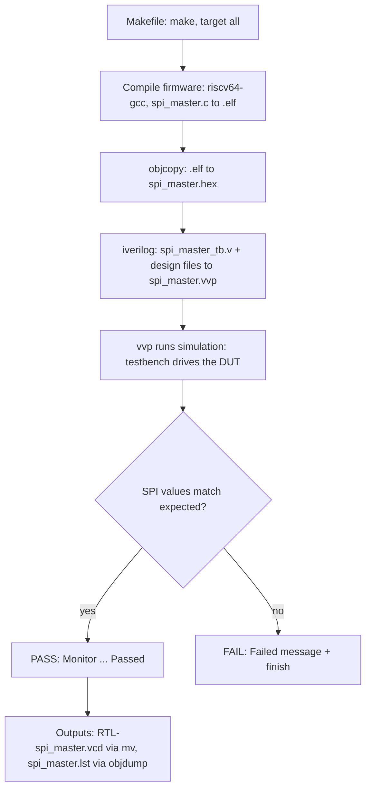

<div align="center">

# 🧪 Week 3 · Phase 1 — Standalone Block Verification

**Block under test: `spi_master` · VSDSquadron SoC (Caravel management SoC)**


*Author: Mysha Fathima · Date: 2 November 2026*

</div>

---

## 📌 1. Objective

Run the standalone `spi_master` test of the VSDSquadron SoC, decide whether it passes or fails, and understand the Makefile-driven verification flow: `make → compile → simulate → result`.

## 🖥️ 2. Environment

| Item | Value |
|---|---|
| Platform | GitHub Codespaces, Ubuntu 24.04 |
| Repository | [vsdip/vsdsquadron-soc](https://github.com/vsdip/vsdsquadron-soc), branch `add-vsdsquadron-soc-folders` |
| Test location | `caravel_mgmt_soc_litex/verilog/dv/tests-standalone/spi_master` |
| Simulator | Icarus Verilog (`iverilog` + `vvp`) |
| Firmware compiler | `riscv64-unknown-elf-gcc` 13.2.0 (installed with `apt`) |
| Target CPU | VexRiscv, `rv32i`, ABI `ilp32` |
| Simulation type | RTL (`SIM=RTL`, `CONFIG=standalone`) |

## ▶️ 3. Execution Steps

```bash
# 1. Clone (shallow, to save disk space)
git clone --depth 1 -b add-vsdsquadron-soc-folders https://github.com/vsdip/vsdsquadron-soc

# 2. Go to the test
cd vsdsquadron-soc/caravel_mgmt_soc_litex/verilog/dv/tests-standalone/spi_master

# 3. Load path settings (see evidence/env_setup.sh)
source /workspaces/week3_env.sh

# 4. Run
make clean
make CPUFLAGS_vexriscv="-march=rv32i_zicsr -mabi=ilp32 -D__vexriscv__"
```

## ✅ 4. Result

| Test (tests-standalone) | Status (sky130) |
|---|---|
| spi_master | ✅ **PASS** |

Verdict line printed by the testbench: `Monitor: Test SPI Master (RTL) Passed`

📸 **Screenshot: successful simulation**


## 🔄 5. Verification Flow



✏️ **My diagram (drawn by me):**


## 🧩 6. Makefile Understanding

| Rule | Needs | What it does |
|---|---|---|
| `all` | `.vcd`, `.lst` | Default target, builds everything |
| `prepare-generated` / `check-fw` | none | Creates the `generated/` folder and the linker file `regions.ld` |
| `%.elf` | `%.c`, `check-fw` | Compiles C firmware with `riscv64-unknown-elf-gcc` |
| `%.hex` | `%.elf` | `objcopy -O verilog` makes the memory image |
| `%.vvp` | `%_tb.v`, `%.hex` | `iverilog` compiles testbench and design files |
| `%.vcd` | `%.vvp` | `vvp` runs the simulation and `mv` saves the waveform |
| `%.lst` | `%.elf` | `objdump -d -S` makes the disassembly listing |
| `clean` | none | Deletes `.elf .hex .bin .vvp .log .vcd .lst` |

> `%` is a wildcard for the test name, `$<` is the first input and `$@` is the output file.

📸 **Screenshot: Makefile rules**


## ❓ 7. How PASS / FAIL is Decided

1. The Makefile does **not** judge the result. It only builds and runs the simulation.
2. The testbench `spi_master_tb.v` reads the SPI value from the DUT and compares it with the expected values `0x02, 0x63, 0x57, 0xb5, 0x00, 0x23, 0x20`.
3. Any mismatch prints `Monitor: Test SPI Master Failed` and calls `$finish`.
4. If all values match, it prints `Monitor: Test SPI Master (RTL) Passed`, then `$finish`.

📸 **Screenshot: testbench checks**


## 🛠️ 8. Issues Faced and Fixes

| # | Problem | Cause | Fix |
|---|---|---|---|
| 1 | No RISC-V compiler | Not installed in Codespace | `sudo apt install gcc-riscv64-unknown-elf` |
| 2 | Makefile points to `/home/vsduser/...` | Paths belong to the course VM | Set `DESIGNS`, `GCC_PATH`, `GCC_PREFIX` in `env_setup.sh`; symlink `/home/vsduser/caravel` |
| 3 | `csrw ... extension 'zicsr' required` | New GCC 13 needs the CSR extension named in `-march` | Run with `CPUFLAGS_vexriscv="-march=rv32i_zicsr ..."` |
| 4 | SRAM model `cvc-pdk/...v` not found | File sits in `dv/vip/` | `ln -s dv/vip cvc-pdk` |

## 📂 9. Evidence Files

| File | Purpose |
|---|---|
| [`evidence/spi_master_run.log`](evidence/spi_master_run.log) | Full simulation log |
| [`evidence/spi_master_Makefile.txt`](evidence/spi_master_Makefile.txt) | Makefile used |
| [`evidence/spi_master.lst`](evidence/spi_master.lst) | Firmware disassembly |
| [`evidence/env_setup.sh`](evidence/env_setup.sh) | Path settings used for the run |
| `evidence/*.png` | Screenshots |
| `diagrams/spi_master_flow.png` | Hand-drawn flow diagram |

## 🏁 10. Conclusion

The standalone `spi_master` test **passes** in RTL simulation. I understood the full chain: Makefile rules, firmware build, Verilog compile, simulation, and the testbench's PASS/FAIL check.