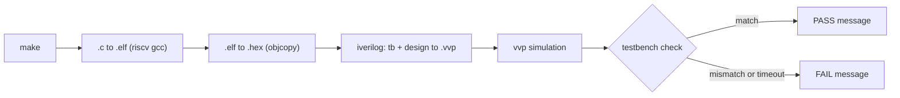
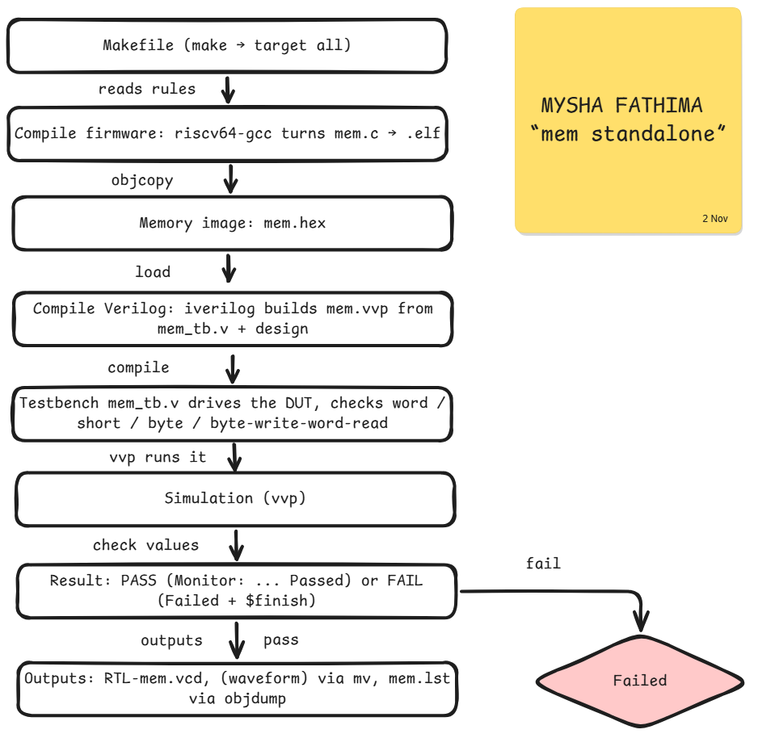
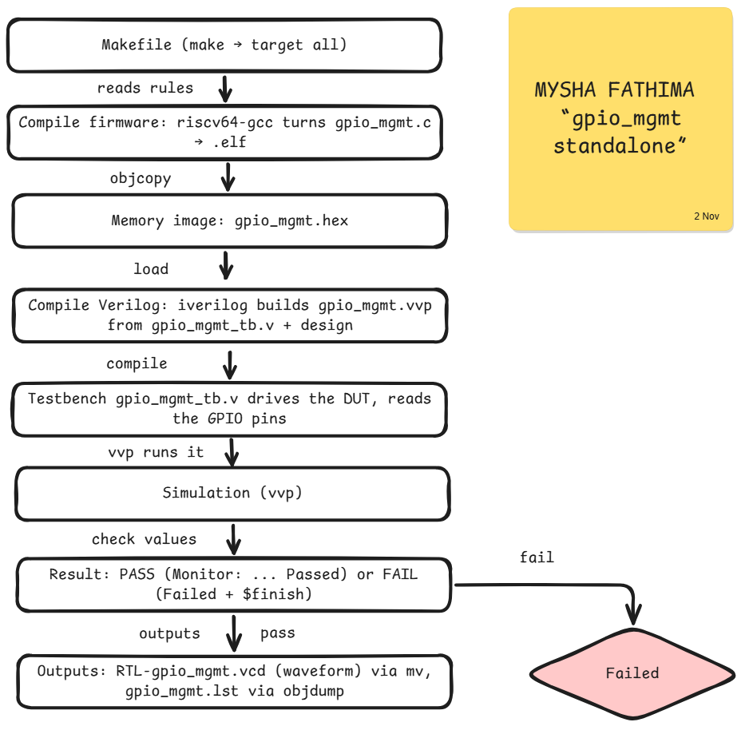
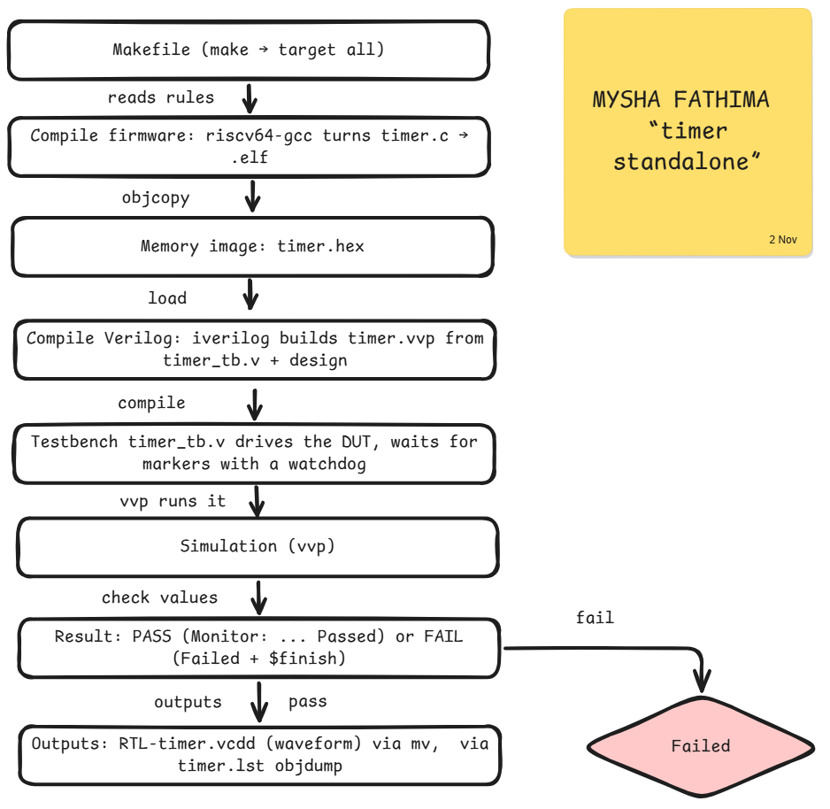
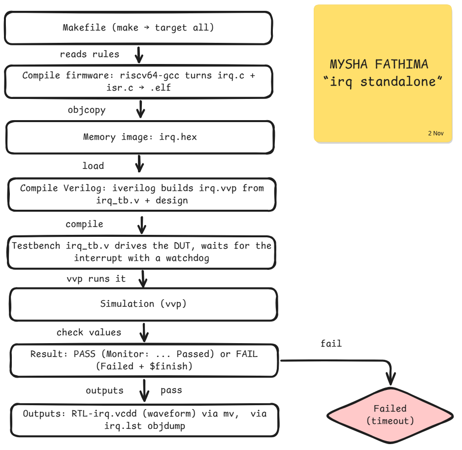
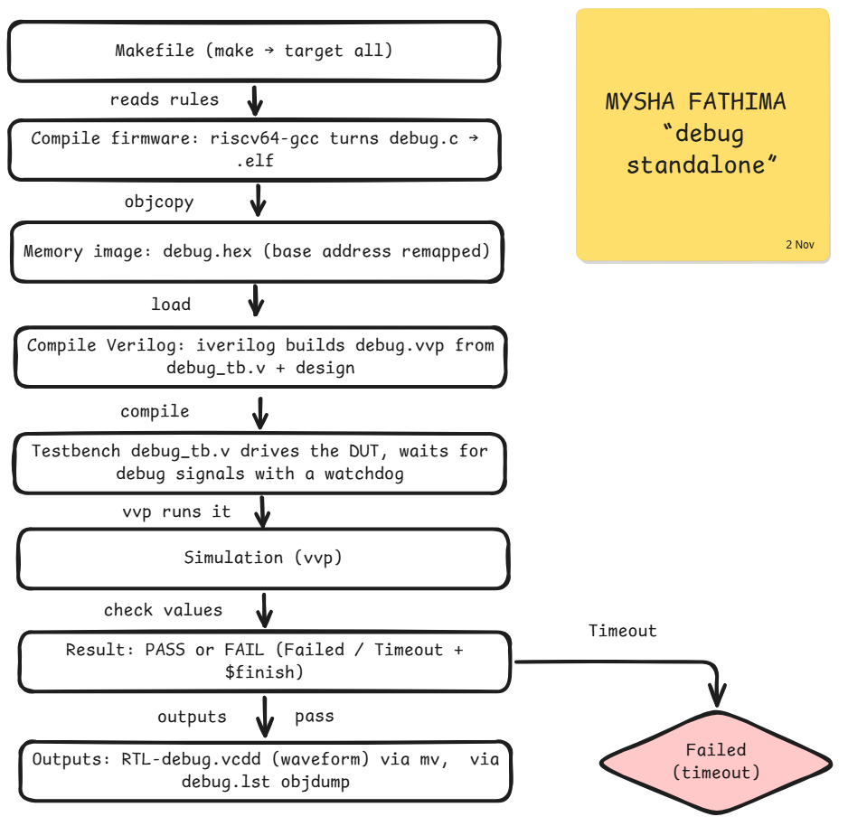

<div align="center">

# 🧪 Week 3 · Phase 2 — All Standalone Tests

*Author: Mysha Fathima · Date: 2 November 2026*

  

</div>

---

## 📑 Contents

| # | Section |
|---|---|
| 1 | [Method](#1--method) |
| 2 | [Result Table](#2--result-table) |
| 3 | [Makefile Study](#3--makefile-study) |
| 4 | [Failure Analysis](#4--failure-analysis) |
| 5 | [Verification Flow Diagrams and Explanations](#5--verification-flow-diagrams-and-explanations) |
| 6 | [Commands Used](#6--commands-used) |
| 7 | [Conclusion](#7--conclusion) |

---

## 1 · Method

For every block under `tests-standalone`: enter the folder, run `make clean`, run `make`, read the testbench verdict, record PASS or FAIL, study the Makefile, draw the flow.

```bash
/workspaces/run_test.sh <test>
# helper script: make clean + make with the Phase 1 fixes, saves the log to evidence/
for t in gpio_mgmt uart timer irq debug; do /workspaces/run_test.sh $t; done
```

Same environment and fixes as [Phase 1](../Phase1-standalone-verification/README.md#5--issues-faced-and-fixes).

## 2 · Result Table

| tests-standalone | status (sky130) | Verdict line in the log | Log |
|---|---|---|---|
| GPIO Mgmt | ✅ PASS | `Test Mgmt GPIO (RTL) Passed` | [log](evidence/gpio_mgmt_run.log) |
| mem | ✅ PASS | `[word rw] [short rw] [byte rw] [byte w word r] passed` | [log](evidence/mem_run.log) |
| uart | ✅ PASS | `Test UART (RTL) passed` | [log](evidence/uart_run.log) |
| timer | ❌ FAIL (timeout) | `Timeout, Test GPIO (RTL) Failed` | [log](evidence/timer_run.log) |
| irq | ❌ FAIL (timeout) | `Timeout, Test IRQ (RTL) Failed` | [log](evidence/irq_run.log) |
| debug | ❌ FAIL (timeout) | `Timeout, Test Debug (RTL) Failed` | [log](evidence/debug_run.log) |
| spi_master | ✅ PASS | `Test SPI Master (RTL) Passed` | [Phase 1 log](../Phase1-standalone-verification/evidence/spi_master_run.log) |

**📸 Screenshot 2.1 — all verdict lines (`grep -H "Monitor:" *_run.log`)**


<br><br><br>

## 3 · Makefile Study

| Test | Compared with the `spi_master` Makefile | Evidence |
|---|---|---|
| mem, timer | identical (`diff -q`) | none needed |
| irq | adds `isr.c` to `SOURCE_FILES` (interrupt service routine) | [diff](evidence/irq_makefile_diff.txt) |
| debug | memory base remapped (`@10000000` becomes `@00000000` in the hex step) | [diff](evidence/debug_makefile_diff.txt) |
| gpio_mgmt | differs | [diff](evidence/gpio_mgmt_makefile_diff.txt) |
| uart | differs | [diff](evidence/uart_makefile_diff.txt) |

All Makefiles share the same flow:



**📸 Screenshot 3.1 — Makefile diff output**


<br><br><br>

## 4 · Failure Analysis

| Test | What happened | Observation |
|---|---|---|
| timer | `Test Timer (RTL) Started`, then the 50 × 1000-cycle watchdog expired | `Timer state = 0` in the log, so the timer never counted. Most checks in `timer_tb.v` are commented out |
| irq | `Test IRQ (RTL) Started`, then timeout | The firmware uses an interrupt service routine (`isr.c`) |
| debug | timeout | Memory map differs in the Makefile |

**Possible cause (not yet confirmed):** I compiled with GCC 13.2 and `-march=rv32i_zicsr`. The course Makefile expects GCC 8.3 (2019). CSR and interrupt behaviour may differ between the two. **Next step:** repeat these three with the course toolchain. For now, the results are recorded as observed.

**📸 Screenshot 4.1 — timer log, last lines**


<br><br><br>

## 5 · Verification Flow Diagrams and Explanations

Every test follows the same chain: **Makefile → Compilation → Testbench → DUT → Simulation → Result**. These are the differences per test.

### 5.1 mem — ✅ PASS

**What it checks:** reads and writes the SoC memory in four access sizes: word, short, byte, and byte-write then word-read.
**Flow:** `mem.c` → `.elf` → `.hex` → `iverilog` (`mem_tb.v` + design) → `vvp`. The testbench prints one `passed` line per access type, and the test passes when all four appear.



### 5.2 gpio_mgmt — ✅ PASS

**What it checks:** the management GPIO pins, which the firmware drives and the testbench reads back.
**Flow:** same as `spi_master`. The testbench watches the GPIO pins, then prints `Test Mgmt GPIO (RTL) Passed`.



### 5.3 uart — ✅ PASS

**What it checks:** the UART serial port. The firmware sends data, and the testbench acts as a receiver to check it.
**Flow:** same chain. The testbench prints `Test UART (RTL) passed` after the UART output is verified.


### 5.4 timer — ❌ FAIL (timeout)

**What it checks:** timer 0. The firmware configures it, reads the countdown values onto the logic-analyzer pins (`reg_la0_data`), and sets marker values (`0x0a`, `0x02` to `0x05`) on `reg_la1_data`. The testbench waits for each marker, then checks the values.
**Flow:** same chain, plus a **watchdog loop** (50 × 1000 clock cycles) in the testbench. The log shows `Timer state = 0`, so the expected values never appeared. The watchdog fired and printed the timeout message.



### 5.5 irq — ❌ FAIL (timeout)

**What it checks:** that an interrupt reaches the CPU and the interrupt service routine runs.
**Flow difference:** the Makefile also compiles `isr.c` together with `irq.c` and the startup file. The testbench never saw the expected event before the watchdog expired.



### 5.6 debug — ❌ FAIL (timeout)

**What it checks:** the SoC debug path, which the firmware uses to signal progress to the testbench.
**Flow difference:** the hex step remaps the base address (`@10000000` to `@00000000`), so the memory image loads at a different address from the other tests. The simulation ends by watchdog timeout.



## 6 · Commands Used

| Command | What it does |
|---|---|
| `for t in a b c; do ...; done` | Repeats a command once per test name |
| `diff A B > file` | Saves the differences between two files |
| `diff -q A B` | Only reports whether two files differ |
| `grep -H "Monitor:" *_run.log` | Prints every verdict line with its file name |
| `cut -c1-110` | Trims each line to 110 characters |
| `tail -30 file` | Shows the last 30 lines of a log |
| `E="path"` then `"$E/file"` | Stores a path in a variable and reuses it |
| `cd "$E" && grep ...` | Runs the second command only if `cd` succeeded |
| `chmod +x`, `source`, `tee`, `make` | See the Phase 1 README |

## 7 · Conclusion

All 7 standalone tests were executed. **4 pass** (`spi_master`, `mem`, `gpio_mgmt`, `uart`) and **3 time out** (`timer`, `irq`, `debug`). I recorded the failures with their logs. The probable cause is a newer compiler than the course expects, to be tested with the course's original toolchain.
