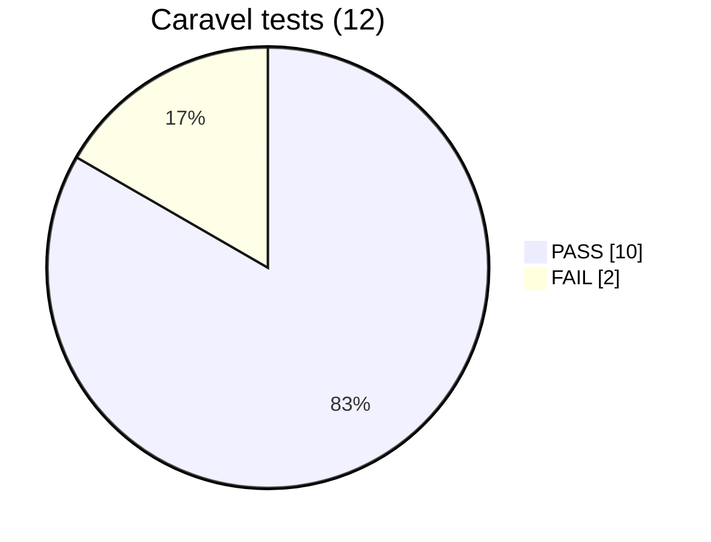
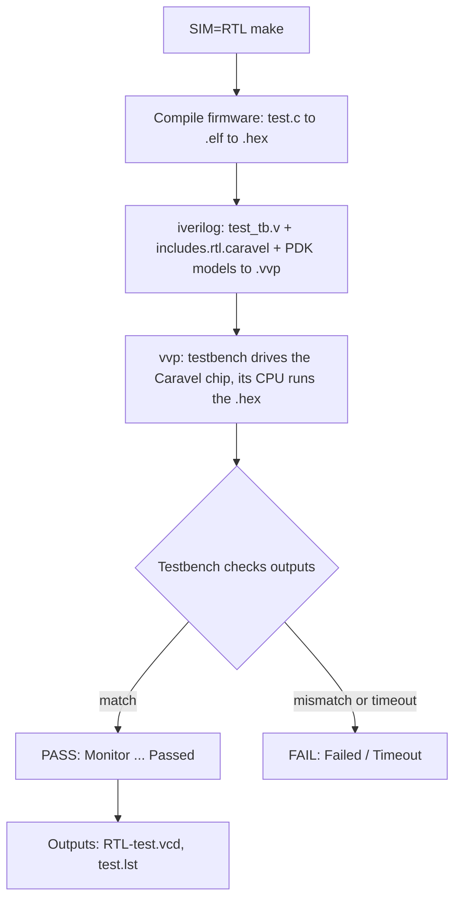

<div align="center">

# 🧪 Week 3 · Phase 3 — Caravel Integrated Tests

### Verifying the VSDSquadron management SoC inside the full Caravel chip


**Author:** Mysha Fathima  ·  **Date:** 3 November 2026  ·  **Mode:** `SIM=RTL`

[⬅ Phase 2](../Phase2-standalone-tests/README.md) · [Phase 4 ➡](../Phase4-verification-flow/README.md) · [Week 3 index](../Phase5-documentation/README.md)

</div>

---

## 📑 Contents

| # | Section |
|---|---|
| 1 | [Objective and what is different from Phase 2](#1--objective-and-what-is-different-from-phase-2) |
| 2 | [Environment setup](#2--environment-setup) |
| 3 | [Results](#3--results) |
| 4 | [Makefile flow](#4--makefile-flow) |
| 5 | [Workarounds applied](#5--workarounds-applied) |
| 6 | [Failure analysis](#6--failure-analysis) |
| 7 | [Flow diagrams](#7--flow-diagrams) |
| 8 | [Commands used](#8--commands-used) |
| 9 | [Key takeaways](#9--key-takeaways) |

---

## 1 · 🎯 Objective and what is different from Phase 2

Phase 2 tested the management SoC **on its own**. Phase 3 tests the same blocks **inside Caravel**, the full chip wrapper that adds the I/O pads, the housekeeping SPI, the GPIO control blocks and the PLL. If a block works alone but fails here, the problem is in the integration.

| | Phase 2 — standalone | Phase 3 — Caravel |
|---|---|---|
| What is simulated | management SoC only | SoC + pads + housekeeping + GPIO blocks |
| Include list | `includes.rtl.standalone` | `includes.rtl.caravel` |
| Needs the PDK? | no | **yes** (pad and cell Verilog models) |
| Number of tests | 7 | 12 |
| Run command | `make` | `SIM=RTL make` |

## 2 · 🖥️ Environment setup

> [!NOTE]
> The Caravel simulation needs Sky130 Verilog models for the I/O pads, standard cells and SRAM. These were the main new requirement of this phase.

| Item | Value |
|---|---|
| Platform | GitHub Codespaces, Ubuntu 24.04 |
| Simulator | Icarus Verilog 13.0 (`iverilog` compiles, `vvp` runs) |
| Firmware compiler | `riscv64-unknown-elf-gcc` 13.2.0 |
| PDK manager | `ciel` 3.2.0 |
| PDK build | `792ef67037d74c8c51811eab3ce23cf793491296`, family `sky130`, variant `sky130A` |
| Libraries installed | `sky130_fd_io`, `sky130_fd_sc_hd`, `sky130_fd_sc_hvl`, `sky130_sram_macros` (only these four, because the disk was nearly full) |
| PDK location | `PDK_ROOT=/workspaces/pdk` |

<details>
<summary><b>Click to see the setup commands</b></summary>

```bash
pip install --user --upgrade ciel
ciel enable --pdk-family sky130 --pdk-root /workspaces/pdk \
  -l sky130_fd_io -l sky130_fd_sc_hd -l sky130_fd_sc_hvl -l sky130_sram_macros \
  792ef67037d74c8c51811eab3ce23cf793491296
source /workspaces/week3_env.sh          # DESIGNS, PDK_ROOT, PDK, GCC_PATH, GCC_PREFIX
/workspaces/run_caravel.sh <test>        # make clean + make, log saved to evidence/
```

Scripts used: [`week3_env.sh`, `run_test.sh`, `run_caravel.sh`](../Phase5-documentation/scripts/)

</details>

**📸 Screenshot 2.1 — PDK installed (`ciel enable` output and the library folder listing)**

*(paste screenshot here)*

<br><br><br>

## 3 · ✅ Results



| # | tests-caravel | status | Verdict line in the log | Log |
|---|---|---|---|---|
| 1 | user_pass_thru | ✅ PASS | `Test HK SPI Pass-thru (RTL) Passed` | [log](evidence/user_pass_thru_run.log) |
| 2 | uart | ✅ PASS | `UART Test (RTL) passed` | [log](evidence/uart_run.log) |
| 3 | sysctrl | ❌ FAIL | `Timeout, Test Sysctrl (RTL) Failed` | [log](evidence/sysctrl_run.log) |
| 4 | sram_exec | ✅ PASS | `Test SRAM exec (RTL) Passed` | [log](evidence/sram_exec_run.log) |
| 5 | spi_master | ✅ PASS | `Test SPI Master (RTL) Passed` | [log](evidence/spi_master_run.log) |
| 6 | pullupdown | ✅ PASS | `Test Pullupdown (RTL) Passed` | [log](evidence/pullupdown_run.log) |
| 7 | pll | ❌ FAIL | `Test PLL Failed` | [log](evidence/pll_run.log) |
| 8 | pass_thru_fix | ✅ PASS | `Test HK SPI Pass-thru fix (RTL) Passed` | [log](evidence/pass_thru_fix_run.log) |
| 9 | mem | ✅ PASS | `[short rw] [byte rw] [byte w word r] passed` | [log](evidence/mem_run.log) |
| 10 | hkspi_power | ✅ PASS | `Test HK SPI (RTL) Passed` | [log](evidence/hkspi_power_run.log) |
| 11 | gpio_mgmt | ✅ PASS | `Test Mgmt GPIO (RTL) Passed` | [log](evidence/gpio_mgmt_run.log) |
| 12 | hkspi | ✅ PASS | `Test HK SPI (RTL) Passed` | [log](evidence/hkspi_run.log) |

**📸 Screenshot 3.1 — last verdict line of every log**

*(paste screenshot here)*

<br><br><br>

## 4 · 🔄 Makefile flow



The course's own `run.sh` runs `SIM=RTL make` and then `grep Monitor` on the log. I followed the same method, with the compile fixes below.

**📸 Screenshot 4.1 — Makefile include and `iverilog` lines**

*(paste screenshot here)*

<br><br><br>

## 5 · 🛠️ Workarounds applied

> [!IMPORTANT]
> No course RTL logic was changed. Every workaround is an environment fix, a placeholder, or a documented testbench edit, and each has evidence.

| # | Problem seen | Why it happened | What I did | Evidence |
|---|---|---|---|---|
| 1 | `gpio_defaults_block_0403.v` not found | The include list names three gate-level files, and `caravel/verilog/gl/` is not in the clone | Created three empty placeholder files. The RTL simulation does not use them | `ls` of the folder |
| 2 | `sky130_fd_io.v` not found | PDK not installed | Installed four libraries with `ciel` | Screenshot 2.1 |
| 3 | Paths point to `/home/vsduser/...` | Course VM layout | Settings file `week3_env.sh` + one symlink | [scripts](../Phase5-documentation/scripts/) |
| 4 | `Unable to bind 'i' in write_byte` in 4 tests | `integer i;` declared after the tasks that use it. Icarus 13 is stricter than the course's version | Moved `integer i;` above the first task. Originals kept as `*_tb.v.orig` | [4 diff files](evidence/) |
| 5 | Disk 100% full | PDK download plus old Bazel caches | Cleared the caches, deleted `.vcd` files after each run | `df -h` before and after |

## 6 · 🔎 Failure analysis

| Test | What the log shows | Reading |
|---|---|---|
| **sysctrl** | `Test 0 Started` → `ucount = 0 ccount = 0` → `Test 1 Started` → timeout | The clock counters stayed at 0, so the watchdog expired before the expected values appeared |
| **pll** | `Test 1 PLL Started` → `ucount = 12 ccount = 12` → `Test 2 PLL Started` → same counts → `Test PLL Failed` | The counts did not change in test 2 as the testbench expects |

> [!WARNING]
> **Hypothesis, not confirmed:** both tests depend on clock timing. My toolchain (GCC 13, Icarus 13) is newer than the one the course used, and the standalone timeouts in Phase 2 showed the same pattern. Next step: repeat these runs with the course's original compiler.

**📸 Screenshot 6.1 — end of the `sysctrl` and `pll` logs**

*(paste screenshot here)*

<br><br><br>

## 7 · 🖼️ Flow diagrams

Hand-drawn in Excalidraw. All follow **Makefile → Compilation → Testbench → DUT → Simulation → Result**.

| Test | What the block checks | Diagram |
|---|---|---|
| user_pass_thru | Housekeeping SPI passes commands to the user flash |  |
| uart | UART output of the management SoC |  |
| sysctrl | System-control clock counters (**FAIL**) |  |
| sram_exec | CPU executes code from SRAM |  |
| spi_master | SPI master transfers |  |
| pullupdown | GPIO pull-up / pull-down states |  |
| pll | PLL clock counts (**FAIL**) |  |
| pass_thru_fix | Flash data setup time |  |
| mem | Word, short, byte memory access |  |
| hkspi_power | Housekeeping SPI registers (power variant) |  |
| gpio_mgmt | Management GPIO pins |  |
| hkspi | Housekeeping SPI registers |  |

## 8 · 💻 Commands used

<details>
<summary><b>Click to expand the command table</b></summary>

| Command | What it does |
|---|---|
| `pip install --user ciel` | Installs the PDK manager |
| `ciel ls-remote --pdk-family sky130` | Lists the available PDK builds |
| `ciel enable --pdk-family sky130 -l <lib> <hash>` | Downloads only the named libraries |
| `export PDK_ROOT=...` | Tells the Makefile where the PDK is |
| `touch file` | Creates an empty file |
| `find . -name "x*"` | Finds files by name |
| `grep -v "pattern"` | Prints lines that do not match |
| `sed -i 's/a/b/' file` | Edits a file in place |
| `diff a b > file` | Saves the differences between two files |
| `timeout 900 <cmd>` | Stops a command that runs longer than 15 minutes |
| `for t in a b; do ...; done` | Repeats a command for each test |
| `du -sh`, `df -h` | Folder size, free disk space |
| `rm -rf <folder>` | Deletes a folder (used only on caches) |

</details>

## 9 · 💡 Key takeaways

- A block can pass standalone and still need extra setup to run in the full chip.
- Reading the **first** error and the file it names solved five different problems.
- Keeping `.orig` copies and `diff` files makes every change reviewable.
- Recording a failure with its evidence is a valid result.

<div align="center">

**10 / 12 pass · 2 documented failures · every claim backed by a log**

</div>