<div align="center">

# 🧪 Week 3 · Phase 3 — Caravel Integrated Tests

*Author: Mysha Fathima · Date: 3 November 2026*

  

</div>

---

## 📑 Contents

| # | Section |
|---|---|
| 1 | [Objective](#1--objective) |
| 2 | [Environment Setup (new for Caravel)](#2--environment-setup-new-for-caravel) |
| 3 | [Result Table](#3--result-table) |
| 4 | [Makefile Flow](#4--makefile-flow) |
| 5 | [Workarounds Applied](#5--workarounds-applied) |
| 6 | [Failure Analysis](#6--failure-analysis) |
| 7 | [Flow Diagrams and Explanations](#7--flow-diagrams-and-explanations) |
| 8 | [Commands Used](#8--commands-used) |
| 9 | [Conclusion](#9--conclusion) |

---

## 1 · Objective

Run every test under `tests-caravel` (blocks verified inside the full Caravel chip environment), record PASS / FAIL, understand the Makefile flow and draw a verification flow for each test.

## 2 · Environment Setup (new for Caravel)

Caravel tests simulate the **whole chip** (management SoC + pads), so they need the **Sky130 PDK Verilog models** that the standalone tests did not.

| Item | Value |
|---|---|
| Simulator | Icarus Verilog 13.0 (`iverilog`, `vvp`) |
| Simulation mode | `SIM=RTL` (as in the course's `run.sh`) |
| PDK manager | `ciel` 3.2.0 (`pip install --user ciel`) |
| PDK | sky130A, build `792ef67037d74c8c51811eab3ce23cf793491296` |
| Libraries installed | `sky130_fd_io`, `sky130_fd_sc_hd`, `sky130_fd_sc_hvl`, `sky130_sram_macros` (only these, to save disk) |
| PDK location | `PDK_ROOT=/workspaces/pdk`, `PDK=sky130A` |

```bash
ciel enable --pdk-family sky130 --pdk-root /workspaces/pdk \
  -l sky130_fd_io -l sky130_fd_sc_hd -l sky130_fd_sc_hvl -l sky130_sram_macros \
  792ef67037d74c8c51811eab3ce23cf793491296
/workspaces/run_caravel.sh <test>     # make clean + make (SIM=RTL), log saved to evidence/
```

**📸 Screenshot 2.1 — `ciel enable` finished and PDK library folders listed**

*(paste screenshot here)*

<br><br><br>

## 3 · Result Table

| tests-caravel | status | Verdict line in log | Log |
|---|---|---|---|
| user_pass_thru | ✅ PASS | `Test HK SPI Pass-thru (RTL) Passed` | [log](evidence/user_pass_thru_run.log) |
| uart | ✅ PASS | `UART Test (RTL) passed` | [log](evidence/uart_run.log) |
| sysctrl | ❌ FAIL (timeout) | `Timeout, Test Sysctrl (RTL) Failed` | [log](evidence/sysctrl_run.log) |
| sram_exec | ✅ PASS | `Test SRAM exec (RTL) Passed` | [log](evidence/sram_exec_run.log) |
| spi_master | ✅ PASS | `Test SPI Master (RTL) Passed` | [log](evidence/spi_master_run.log) |
| pullupdown | ✅ PASS | `Test Pullupdown (RTL) Passed` | [log](evidence/pullupdown_run.log) |
| pll | ❌ FAIL | `Test PLL Failed` | [log](evidence/pll_run.log) |
| pass_thru_fix | ✅ PASS | `Test HK SPI Pass-thru fix (RTL) Passed` | [log](evidence/pass_thru_fix_run.log) |
| mem | ✅ PASS | `[short rw] [byte rw] [byte w word r] passed` | [log](evidence/mem_run.log) |
| hkspi_power | ✅ PASS | `Test HK SPI (RTL) Passed` | [log](evidence/hkspi_power_run.log) |
| gpio_mgmt | ✅ PASS | `Test Mgmt GPIO (RTL) Passed` | [log](evidence/gpio_mgmt_run.log) |
| hkspi | ✅ PASS | `Test HK SPI (RTL) Passed` | [log](evidence/hkspi_run.log) |

**📸 Screenshot 3.1 — last verdict line of every log**

*(paste screenshot here)*

<br><br><br>

## 4 · Makefile Flow

The Caravel Makefiles use the same chain as the standalone ones. The difference is **what gets compiled**: the full Caravel chip.

| Stage | Standalone | Caravel |
|---|---|---|
| Firmware | `riscv64-unknown-elf-gcc` → `.elf` → `.hex` | same |
| Design list | `includes.rtl.standalone` | `includes.rtl.caravel` (full chip: pads, housekeeping, GPIO blocks) |
| Extra needs | none | Sky130 PDK models (`sky130_fd_io`, cells, SRAM) via `PDK_ROOT` |
| Run | `make` | `SIM=RTL make` (course `run.sh`) |
| Result | testbench `Monitor:` lines | same |

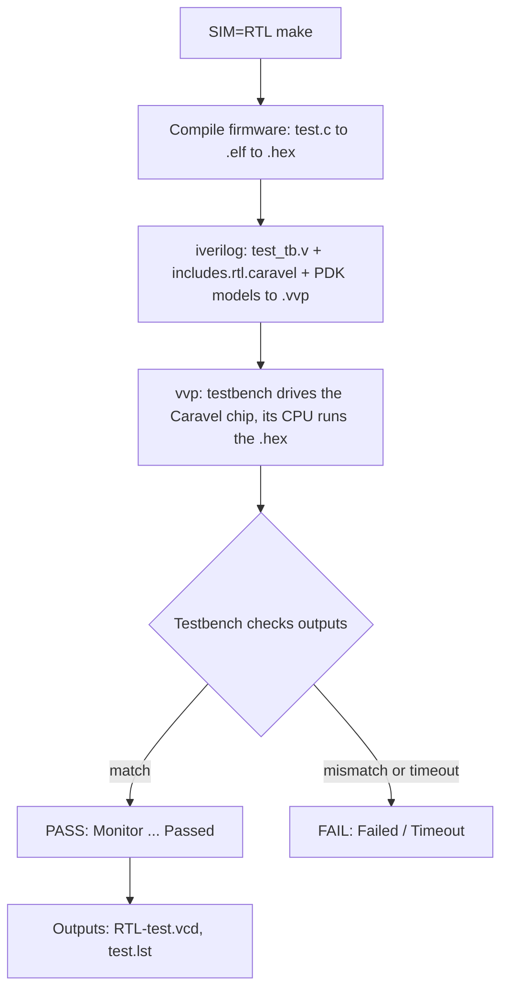

**📸 Screenshot 4.1 — Makefile include and `iverilog` lines (`grep -n "includes\|-f \|-y \|-I " Makefile`)**

*(paste screenshot here)*

<br><br><br>

## 5 · Workarounds Applied

| # | Problem | Cause | Fix |
|---|---|---|---|
| 1 | `gpio_defaults_block_0403.v` etc. not found | Include list names three gate-level files; the `caravel/verilog/gl/` folder is not in the clone | Empty placeholder files (`touch`), no RTL logic changed |
| 2 | `sky130_fd_io.v` not found | PDK not installed | Installed with `ciel`, four libraries only (disk was 2 GB free) |
| 3 | Paths point to `/home/vsduser/...` | Course VM layout | `week3_env.sh` sets `DESIGNS`, `PDK_ROOT`, `PDK`, `GCC_PATH`; symlink `/home/vsduser/caravel` |
| 4 | `Unable to bind 'i' in write_byte` (4 tests) | `integer i;` is declared after the tasks that use it; Icarus 13 is stricter | `integer i;` moved above the first task; originals kept as `*_tb.v.orig`, change saved as [diff](evidence/) files |
| 5 | Disk 100% full | PDK download + Week 2 Bazel caches | Deleted `~/.cache/bazel*` (recreatable), deleted `*.vcd` after each run |

Testbench fix diffs: `user_pass_thru_tb_fix.diff`, `pass_thru_fix_tb_fix.diff`, `hkspi_power_tb_fix.diff`, `hkspi_tb_fix.diff` in [`evidence/`](evidence/).

## 6 · Failure Analysis

| Test | What the log shows | Observation |
|---|---|---|
| sysctrl | `Test 0 Started`, `ucount = 0 ccount = 0`, `Test 1 Started`, then timeout | Counters stayed at 0, so the system-control clock counters did not advance within the time limit |
| pll | `Test 1 PLL Started`, `ucount = 12 ccount = 12`, `Test 2 PLL Started`, same counts, then `Test PLL Failed` | The counts did not change in test 2 as the testbench expects |

**Possible causes (not confirmed):** the PLL and clock tests depend on clock and delay timing. My Icarus 13 and GCC 13 differ from the course's older versions. As with the standalone timeouts, I recorded the result as observed.

**📸 Screenshot 6.1 — sysctrl and pll log, last lines**

*(paste screenshot here)*

<br><br><br>

## 7 · Flow Diagrams and Explanations

Every test follows the same chain: **Makefile → Compilation → Testbench → DUT (Caravel chip) → Simulation → PASS / FAIL**.

| Test | What it checks | Diagram |
|---|---|---|
| user_pass_thru | Housekeeping SPI passes commands through to the user flash | 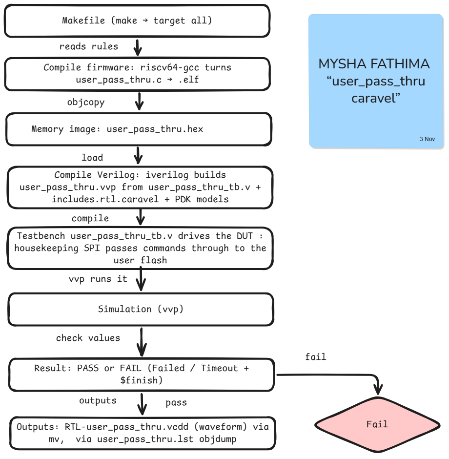 |
| uart | UART output of the management SoC | 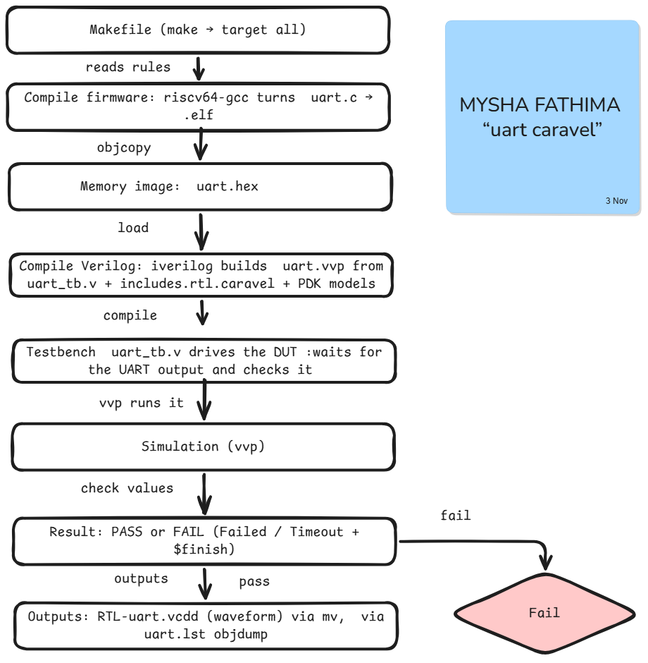 |
| sysctrl | System-control registers and clock counters (**FAIL, timeout**) | 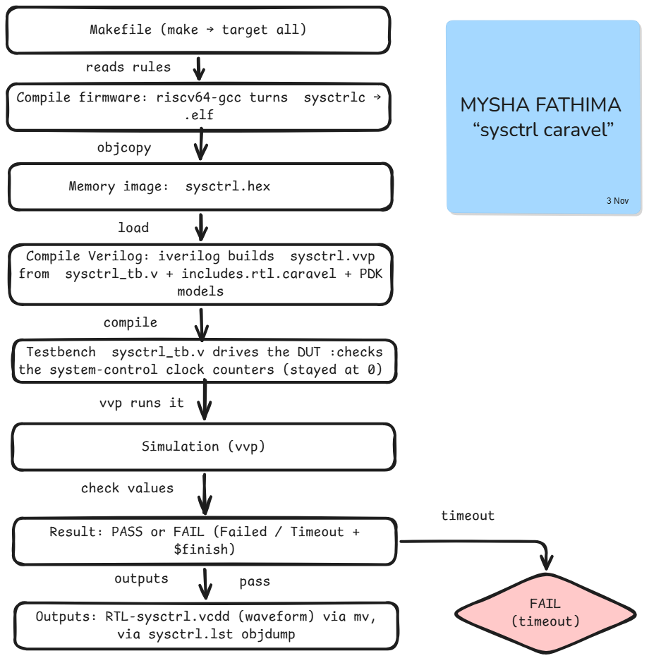 |
| sram_exec | CPU executes code from SRAM (calls an SRAM routine) | 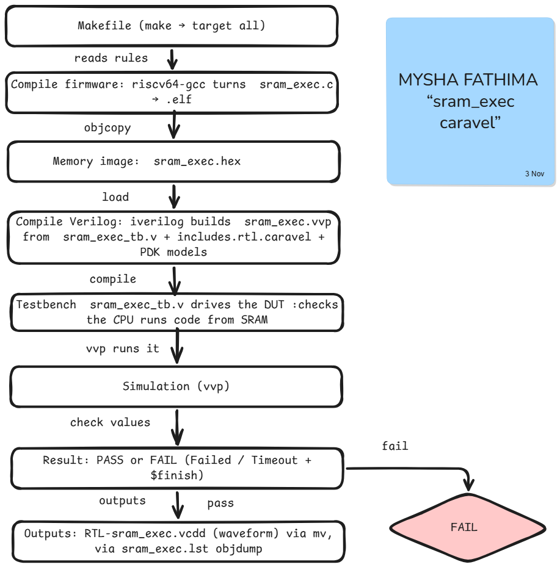 |
| spi_master | SPI master transfers inside Caravel | 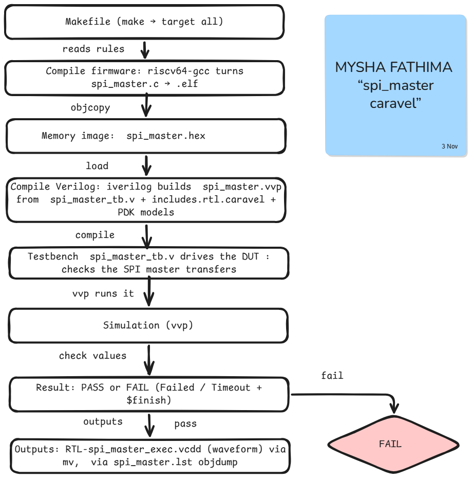 |
| pullupdown | GPIO pull-up and pull-down states, GPIO 0-31 and 32-37 | 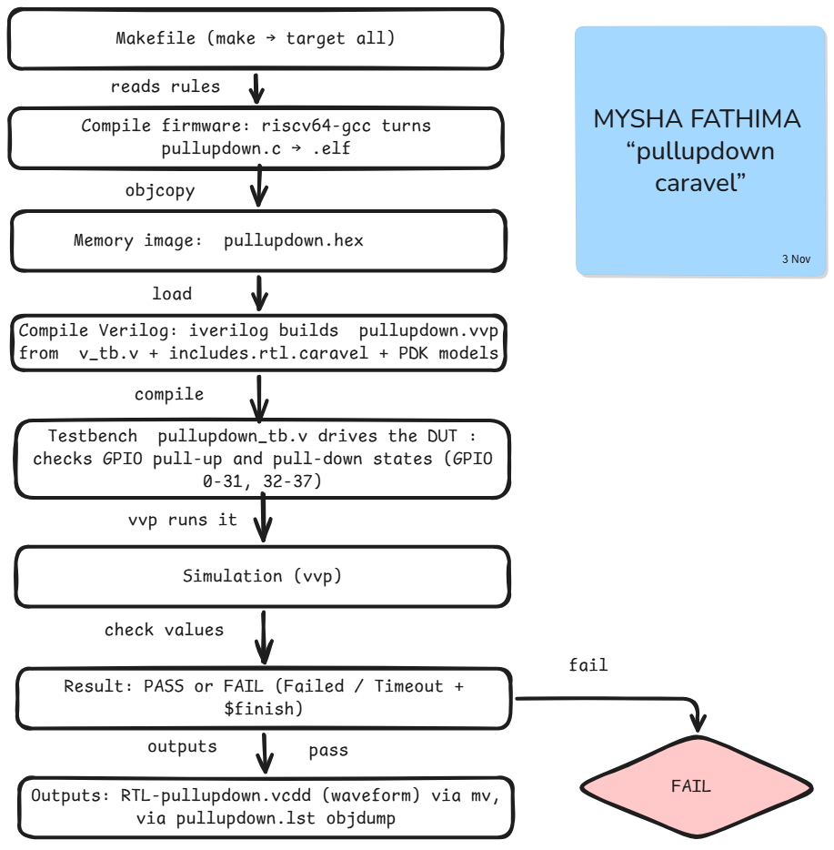 |
| pll | PLL output and clock counts (**FAIL**) | 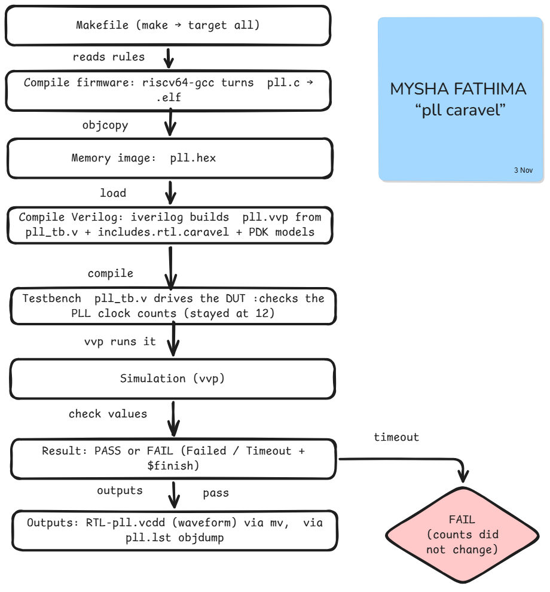 |
| pass_thru_fix | Pass-through with flash data setup time fix | 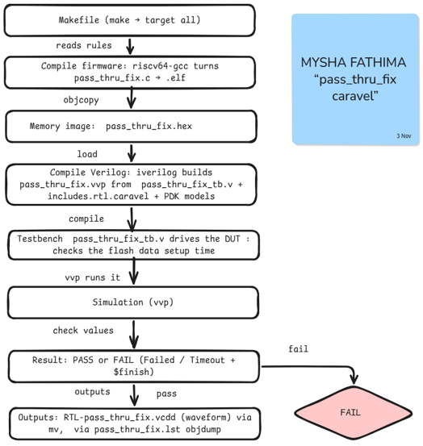 |
| mem | Memory read and write at word, short, byte sizes | 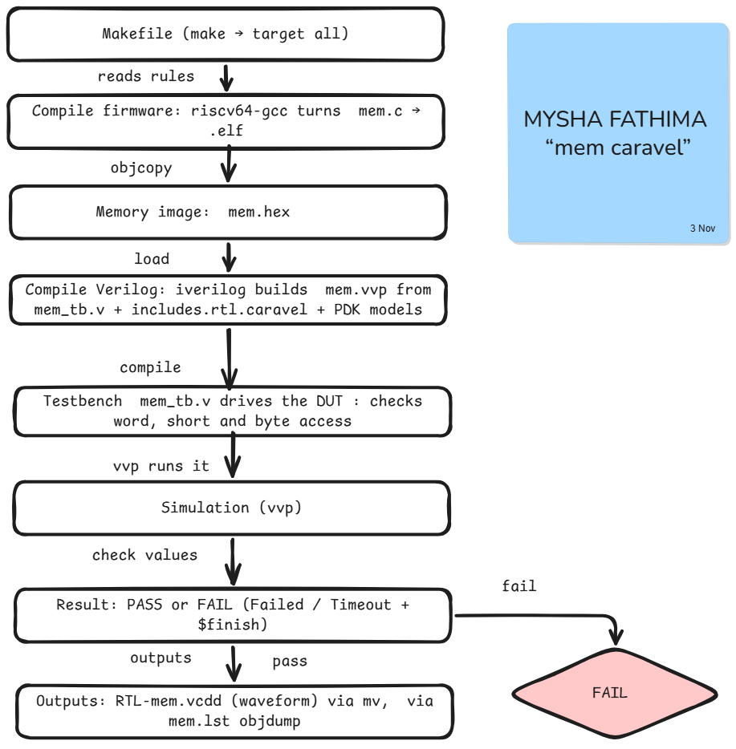 |
| hkspi_power | Housekeeping SPI register access (power variant) | 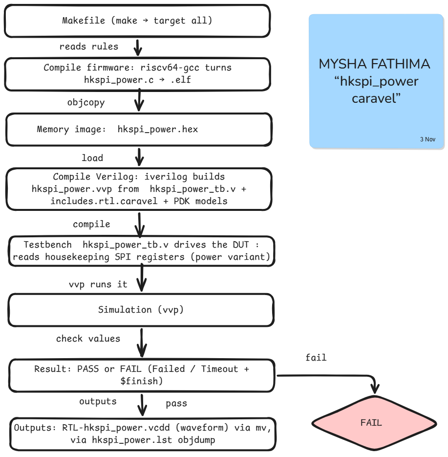 |
| gpio_mgmt | Management GPIO pins |  |
| hkspi | Housekeeping SPI register access | 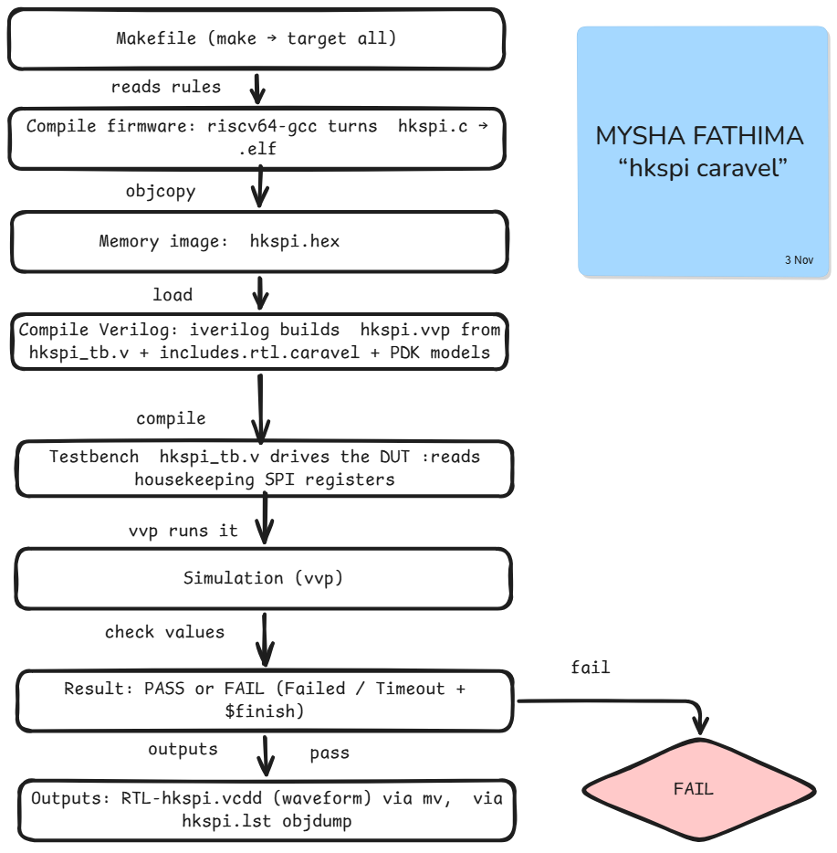 |

## 8 · Commands Used

| Command | What it does |
|---|---|
| `pip install --user ciel` | Installs the PDK manager |
| `ciel enable --pdk-family sky130 -l <lib> <hash>` | Downloads and activates chosen PDK libraries |
| `ciel ls-remote --pdk-family sky130` | Lists available PDK builds |
| `export PDK_ROOT=...` | Tells the Makefile where the PDK is |
| `touch file` | Creates an empty file |
| `find . -name "x*"` | Finds files by name |
| `rm -rf <folder>` | Deletes a folder (used only on caches) |
| `du -sh`, `df -h` | Measure folder size, free disk space |
| `sed -i 's/a/b/' file` | Edits a file in place |
| `diff a b > file` | Saves the difference between two files |
| `timeout 900 <cmd>` | Stops a command that runs too long |
| `for t in a b; do ...; done` | Repeats a command for each test |
| `grep -v "pattern"` | Prints lines that do not match |

## 9 · Conclusion

**10 of 12** Caravel tests pass in RTL simulation. `sysctrl` and `pll` fail and are documented above. Setting up the PDK and fixing four testbench compile errors were the main work of this phase.