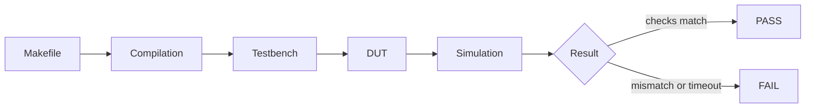

<div align="center">

# 🧠 Week 3 · Phase 4 — Verification Flow Understanding

### How `make` turns a C file and a testbench into a PASS or FAIL


**Author:** Mysha Fathima  ·  **Date:** 4 November 2026

[⬅ Phase 3](../Phase3-caravel-tests/README.md) · [Phase 5 ➡](../Phase5-documentation/README.md)

</div>

---

## 🎯 Goal

Explain, in my own words, the five things the task asks for: what `make` does, how the Makefile calls the simulator, what gets compiled, how the testbench talks to the design, and how PASS or FAIL is decided. The diagram for each test is linked in the table at the end.

## 🗺️ The big picture



| Stage | Tool | Input → Output |
|---|---|---|
| Makefile | `make` | reads rules, builds the target `all` |
| Compilation (firmware) | `riscv64-unknown-elf-gcc`, `objcopy` | `test.c` → `test.elf` → `test.hex` |
| Compilation (design) | `iverilog` | `test_tb.v` + design files → `test.vvp` |
| Testbench + DUT | Verilog | the testbench drives the DUT, whose CPU runs `test.hex` |
| Simulation | `vvp` | runs the `.vvp` and prints messages |
| Result | testbench `$display` + `$finish` | `Passed`, `Failed` or `Timeout` |

---

## 1 · What happens when `make` is executed

`make` reads the Makefile and works **backwards** from its default target `all`:

```
all → test.vcd + test.lst
test.vcd ← test.vvp ← test_tb.v + test.hex
test.hex ← test.elf ← test.c   (+ prepare-generated for the linker file)
```

It sees which files are missing and builds them in order. A file that already exists and is up to date is skipped, which is why `make clean` comes first.

### 🔬 Worked example: my real `spi_master` log

| Line in my log | Stage it belongs to |
|---|---|
| `/usr/bin/riscv64-unknown-elf-gcc -g -march=rv32i_zicsr ... -o spi_master.elf` | Firmware compile |
| `riscv64-unknown-elf-objcopy -O verilog spi_master.elf spi_master.hex` | Memory image |
| `iverilog -Ttyp -DFUNCTIONAL -DSIM ... -o spi_master.vvp ... spi_master_tb.v` | Verilog compile |
| `vvp spi_master.vvp` then `+5000 cycles`, `GPIO state = ...` | Simulation running |
| `SPI value = 0x57 (should be 0x57)` | A testbench check |
| `Monitor: Test SPI Master (RTL) Passed` | The verdict |
| `spi_master_tb.v:179: $finish called` | Simulation ends |
| `mv spi_master.vcd RTL-spi_master.vcd`, `objdump -d -S ... > spi_master.lst` | Outputs saved |

**📸 Screenshot 1.1 — the `spi_master` log with these lines visible**


<br><br><br>

## 2 · How the Makefile invokes the simulator

The `%.vvp` rule runs:

```
iverilog -Ttyp -DFUNCTIONAL -DSIM -DUNIT_DELAY=#1 \
   -f $(VERILOG_PATH)/includes/includes.rtl.<CONFIG> \
   -o <test>.vvp  <test>_tb.v
```

| Piece | Meaning |
|---|---|
| `-DFUNCTIONAL -DSIM` | Turns on the simulation branches in the Verilog (`ifdef`) |
| `-f <list>` | Reads the list of design files to compile |
| `-y`, `-I` | Extra folders to search for modules and `include` files |
| `-o` | Name of the compiled output |

Then the `%.vcd` rule runs `vvp <test>.vvp`. `SIM=RTL`, `GL` or `GL_SDF` select which `ifeq` branch of the Makefile runs. I used RTL.

## 3 · What files are compiled

| Suite | Firmware | Verilog |
|---|---|---|
| Standalone | `<test>.c`, `start_caravel_vexriscv.s`, `sections_vexriscv.lds` | `<test>_tb.v` + the files in `includes.rtl.standalone` (management SoC, SRAM model) |
| Caravel | same | `<test>_tb.v` + `includes.rtl.caravel` (full chip) + Sky130 PDK models |

## 4 · How the testbench interacts with the design

1. It generates the **clock** and **reset**.
2. It instantiates the **DUT** and loads `test.hex` into the design's memory.
3. The DUT's CPU boots and runs the firmware.
4. The firmware signals progress by writing to GPIO pins or to logic-analyzer registers (`reg_la1_data` marker values, for example).
5. The testbench **waits for each marker** and compares the values it sees with the expected ones.
6. Some testbenches also model outside devices, such as a SPI flash, a UART receiver, or a SPI master.

## 5 · How PASS / FAIL is determined

> [!NOTE]
> The Makefile does **not** judge the result. It only builds and runs the simulation. The testbench decides.

| Outcome | What the testbench prints | How it happens |
|---|---|---|
| ✅ PASS | `Monitor: ... Passed` | Every expected value matched |
| ❌ FAIL | `Monitor: ... Failed` | A value did not match the expected one |
| ⏱️ FAIL (timeout) | `Monitor: Timeout, ... Failed` | A watchdog loop (for example 50 × 1000 clock cycles) expired before the expected event |

All three end with `$finish`. I read the verdict from the log.

---

## 📋 All 19 tests at a glance

| Suite | Test | What it checks | Result | Diagram |
|---|---|---|---|---|
| Standalone | spi_master | SPI values 0x02 … 0x20 read back correctly | ✅ | [view](../Phase1-standalone-verification/diagrams/spi_master_flow.png) |
| Standalone | mem | word, short, byte, byte-write/word-read | ✅ | [view](../Phase2-standalone-tests/diagrams/mem_flow.png) |
| Standalone | gpio_mgmt | management GPIO pins | ✅ | [view](../Phase2-standalone-tests/diagrams/gpio_mgmt_flow.png) |
| Standalone | uart | UART output | ✅ | [view](../Phase2-standalone-tests/diagrams/uart_flow.png) |
| Standalone | timer | timer 0 countdown values and markers | ❌ timeout | [view](../Phase2-standalone-tests/diagrams/timer_flow.png) |
| Standalone | irq | interrupt reaches the CPU (`isr.c`) | ❌ timeout | [view](../Phase2-standalone-tests/diagrams/irq_flow.png) |
| Standalone | debug | debug path signalling | ❌ timeout | [view](../Phase2-standalone-tests/diagrams/debug_flow.png) |
| Caravel | user_pass_thru | housekeeping SPI pass-through to the user flash | ✅ | [view](../Phase3-caravel-tests/diagrams/user_pass_thru_flow.png) |
| Caravel | uart | UART output | ✅ | [view](../Phase3-caravel-tests/diagrams/uart_flow.png) |
| Caravel | sysctrl | clock counters | ❌ timeout | [view](../Phase3-caravel-tests/diagrams/sysctrl_flow.png) |
| Caravel | sram_exec | CPU runs a routine from SRAM | ✅ | [view](../Phase3-caravel-tests/diagrams/sram_exec_flow.png) |
| Caravel | spi_master | SPI master transfers | ✅ | [view](../Phase3-caravel-tests/diagrams/spi_master_flow.png) |
| Caravel | pullupdown | GPIO pull-up/down states | ✅ | [view](../Phase3-caravel-tests/diagrams/pullupdown_flow.png) |
| Caravel | pll | PLL clock counts | ❌ | [view](../Phase3-caravel-tests/diagrams/pll_flow.png) |
| Caravel | pass_thru_fix | flash data setup time | ✅ | [view](../Phase3-caravel-tests/diagrams/pass_thru_fix_flow.png) |
| Caravel | mem | word, short, byte access | ✅ | [view](../Phase3-caravel-tests/diagrams/mem_flow.png) |
| Caravel | hkspi_power | housekeeping SPI (power variant) | ✅ | [view](../Phase3-caravel-tests/diagrams/hkspi_power_flow.png) |
| Caravel | gpio_mgmt | management GPIO pins | ✅ | [view](../Phase3-caravel-tests/diagrams/gpio_mgmt_flow.png) |
| Caravel | hkspi | housekeeping SPI registers | ✅ | [view](../Phase3-caravel-tests/diagrams/hkspi_flow.png) |

## 🧾 Self-check

<details>
<summary><b>Questions I can now answer</b></summary>

- Why does `make clean` come before `make`?
- What does `%.vvp: %_tb.v %.hex` tell me about the order of the build?
- Why does the same Makefile work for every test?
- Who decides PASS or FAIL: `make`, `iverilog`, `vvp` or the testbench?
- What does a timeout mean, and why is it still a valid result to record?

</details>

<div align="center">

**One flow, nineteen tests, every verdict read from the testbench**

</div>
