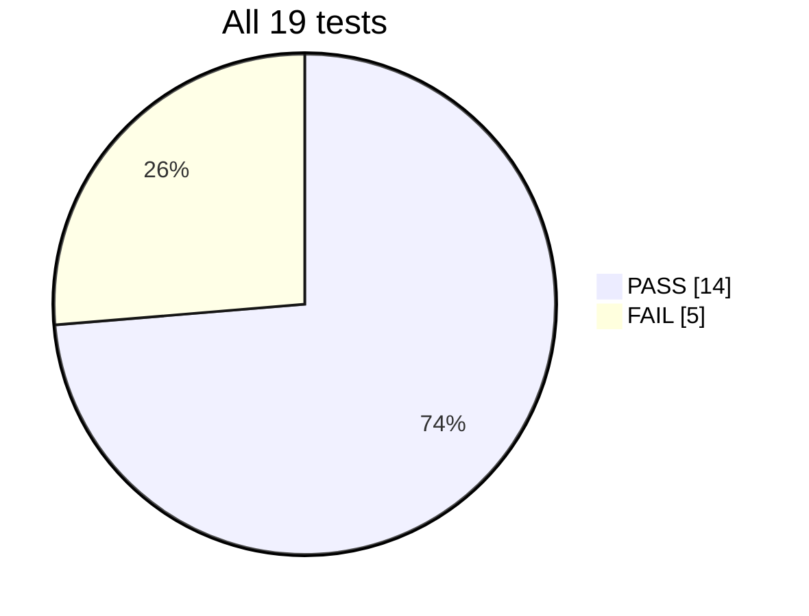

<div align="center">

# 📘 Week 3 · Phase 5 — Documentation

### Block-Level Verification of VSDSquadron SoC — complete record


**Author:** Mysha Fathima  ·  **Period:** 2 – 5 November 2026
**Repository:** [VSDSquadron SoC](https://github.com/vsdip/vsdsquadron-soc) · branch `add-vsdsquadron-soc-folders`

</div>

---

## 🗂️ Navigation

| Phase | What it covers | Link |
|---|---|---|
| 1 | `spi_master` standalone, Task 1 and Task 2 | [Phase 1](../Phase1-standalone-verification/README.md) |
| 2 | All 7 standalone tests | [Phase 2](../Phase2-standalone-tests/README.md) |
| 3 | 12 Caravel integrated tests | [Phase 3](../Phase3-caravel-tests/README.md) |
| 4 | Verification flow understanding | [Phase 4](../Phase4-verification-flow/README.md) |
| 5 | This page | — |

## 📊 Results at a glance



| Suite | Total | PASS | FAIL | Failing tests |
|---|---|---|---|---|
| Standalone | 7 | 4 | 3 | timer, irq, debug (timeout) |
| Caravel | 12 | 10 | 2 | sysctrl (timeout), pll |
| **All** | **19** | **14** | **5** | |

### Standalone results

| tests-standalone | status (sky130) |
|---|---|
| GPIO Mgmt | ✅ PASS |
| mem | ✅ PASS |
| uart | ✅ PASS |
| timer | ❌ FAIL (timeout) |
| irq | ❌ FAIL (timeout) |
| debug | ❌ FAIL (timeout) |
| spi_master | ✅ PASS |

### Caravel results

| tests-caravel | status |
|---|---|
| user_pass_thru | ✅ PASS |
| uart | ✅ PASS |
| sysctrl | ❌ FAIL (timeout) |
| sram_exec | ✅ PASS |
| spi_master | ✅ PASS |
| pullupdown | ✅ PASS |
| pll | ❌ FAIL |
| pass_thru_fix | ✅ PASS |
| mem | ✅ PASS |
| hkspi_power | ✅ PASS |
| gpio_mgmt | ✅ PASS |
| hkspi | ✅ PASS |

---

## ▶️ Execution steps

<details>
<summary><b>Click to expand: how to reproduce everything from scratch</b></summary>

**1. Get the code**
```bash
git clone --depth 1 -b add-vsdsquadron-soc-folders https://github.com/vsdip/vsdsquadron-soc
```

**2. Install the tools**
```bash
sudo apt update && sudo apt install -y gcc-riscv64-unknown-elf
pip install --user --upgrade ciel
ciel enable --pdk-family sky130 --pdk-root /workspaces/pdk \
  -l sky130_fd_io -l sky130_fd_sc_hd -l sky130_fd_sc_hvl -l sky130_sram_macros \
  792ef67037d74c8c51811eab3ce23cf793491296      # Caravel tests only
```

**3. Environment fixes**
```bash
ln -s dv/vip caravel_mgmt_soc_litex/verilog/cvc-pdk                 # SRAM model location
sudo mkdir -p /home/vsduser && sudo ln -s /workspaces/vsdsquadron-soc/caravel /home/vsduser/caravel
mkdir -p caravel/verilog/gl && touch caravel/verilog/gl/gpio_defaults_block_{0403,1803,0801}.v
source scripts/week3_env.sh
```

**4. Run**
```bash
scripts/run_test.sh <test>                       # standalone
scripts/run_caravel.sh <test>                    # Caravel
```

**5. Read the verdict**
```bash
grep -H "Monitor:" evidence/*_run.log
```

All scripts are in [`scripts/`](scripts/).

</details>

## 📸 Screenshots of successful simulations

| Test | Screenshot |
|---|---|
| spi_master (Phase 1) |  |
| mem |  |
| gpio_mgmt |  |
| uart | |
| Caravel run summary |  |

<br><br>

## 🖼️ Diagram index

All diagrams are hand-drawn in Excalidraw, one per test.

| Folder | Count | Link |
|---|---|---|
| Phase 1 | 1 | [diagrams](../Phase1-standalone-verification/diagrams/) |
| Phase 2 | 6 | [diagrams](../Phase2-standalone-tests/diagrams/) |
| Phase 3 | 12 | [diagrams](../Phase3-caravel-tests/diagrams/) |

## 🧩 Short explanation of the verification flow

`make` builds the C firmware into a hex memory image, compiles the testbench and design with `iverilog`, and runs the result with `vvp`. The testbench drives the design under test, waits for markers from the firmware, compares values with the expected ones, and prints `Passed`, `Failed` or `Timeout`. The Makefile never decides the verdict. Full explanation: [Phase 4](../Phase4-verification-flow/README.md).

## 🛠️ Issues and solutions

| # | Problem | Fix |
|---|---|---|
| 1 | No RISC-V compiler | `apt install gcc-riscv64-unknown-elf` |
| 2 | Course paths `/home/vsduser/...` | settings file + symlink |
| 3 | `zicsr` extension error | `-march=rv32i_zicsr` |
| 4 | SRAM model not found | `ln -s dv/vip cvc-pdk` |
| 5 | Missing `gpio_defaults_block_*.v` | empty placeholders |
| 6 | PDK not installed | `ciel`, four libraries |
| 7 | `Unable to bind 'i'` in four testbenches | `integer i;` moved up, diffs saved |
| 8 | Disk 100% full | cleared caches, deleted waveforms |

## ⚠️ Open items

Five tests did not pass: `timer`, `irq`, `debug`, `sysctrl`, `pll`. The likely cause is a toolchain difference, since I used GCC 13 and Icarus 13 while the course expects older versions. This is **not confirmed**. The next experiment is to repeat the five runs with the course's compiler.

## ✅ Completion checklist

- [✅] All standalone tests executed
- [✅] All Caravel tests executed
- [✅] PASS / FAIL results recorded
- [✅] Makefile flow understood
- [✅] Block diagrams drawn manually 
- [✅] Documentation uploaded

## 🗃️ Evidence index

| Evidence | Location |
|---|---|
| Simulation logs, `spi_master` | [`Phase1.../evidence`](../Phase1-standalone-verification/evidence/) |
| Simulation logs and Makefile diffs, standalone | [`Phase2.../evidence`](../Phase2-standalone-tests/evidence/) |
| Simulation logs and testbench fix diffs, Caravel | [`Phase3.../evidence`](../Phase3-caravel-tests/evidence/) |
| Scripts used | [`scripts/`](scripts/) |

## 🔭 What I would do next

1. Repeat the five failing tests with the course's original compiler to test the toolchain hypothesis.
2. Run the optional gate-level modes (`SIM=GL`) once the gate-level files are available.
3. Reuse this flow in Week 4 for the integration tasks.

## 💡 What I learned

- Reading a Makefile as a dependency chain, not a list of commands.
- Why a block can pass alone and still need setup inside the full chip.
- A repeatable debugging method: first error, file and line, what is missing, fix without editing the original, re-run.
- Recording evidence for every claim, including the failures.

<div align="center">

**Week 3 complete · 19 tests run · 14 pass · 5 documented failures**

</div>
