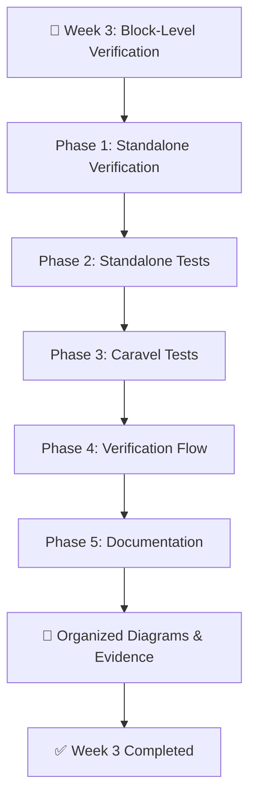

# 🔬 VSD Squadron RTL-to-GDSII Program — Week 3
# Block-Level Verification

<p align="center">
  
  
  
  
</p>

<p align="center">
  <b>Standalone Verification • Standalone Tests • Caravel Tests • Verification Flow • Documentation</b>
</p>

---

## 📌 Overview

Week 3 of the **VSD Squadron RTL-to-GDSII Program** focuses on **Block-Level Verification**.

This week covers the organization and understanding of standalone verification, standalone tests, Caravel-based testing, verification flow concepts, and technical documentation.

The work is organized into five phases, with individual README files, diagrams, evidence, and supporting documentation maintained within the respective folders.

✅ **Week 3 has been completed.**

---

## 🎯 Objectives

- Explore the standalone block-level verification environment.
- Understand standalone testing activities.
- Study Caravel-based test organization.
- Understand the verification flow.
- Maintain phase-wise technical documentation.
- Organize diagrams and evidence for GitHub presentation.
- Develop a structured understanding of block-level verification.

---
## 📚 Week 3 — Phase Index

| Phase | Topic | Documentation |
|---|---|---|
| Phase 1 | Standalone Verification | [📘 Open README](Phase1-standalone-verification/README.md) |
| Phase 2 | Standalone Tests | [📘 Open README](Phase2-standalone-tests/README.md) |
| Phase 3 | Caravel Tests | [📘 Open README](Phase3-caravel-tests/README.md) |
| Phase 4 | Verification Flow | [📘 Open README](Phase4-verification-flow/README.md) |
| Phase 5 | Documentation | [📘 Open README](Phase5-documentation/README.md) |

___

## 📊 Phase-Wise Progress

| Phase | Topic | Folder | Status |
|---|---|---|---|
| 1 | Standalone Verification | `Phase1-standalone-verification` | ✅ Completed |
| 2 | Standalone Tests | `Phase2-standalone-tests` | ✅ Completed |
| 3 | Caravel Tests | `Phase3-caravel-tests` | ✅ Completed |
| 4 | Verification Flow | `Phase4-verification-flow` | ✅ Completed |
| 5 | Documentation | `Phase5-documentation` | ✅ Completed |

<details>
<summary><b>📈 Week 3 Completion Summary</b></summary>

- All five phases completed.
- Phase-wise README documentation maintained.
- Diagrams and evidence folders organized.
- Verification workflow documentation completed.
- Week 3 repository structure finalized.

</details>

---

## 🔄 Block-Level Verification Workflow



---

## 📚 Phase Documentation

### 🔹 Phase 1 — Standalone Verification

📂 [Open Phase 1 README](Phase1-standalone-verification/README.md)

Focus:
- Standalone verification environment.
- Block-level verification concepts.
- Verification setup and workflow.
- Supporting diagrams and evidence.

**Status: ✅ Completed**

### 🔹 Phase 2 — Standalone Tests

📂 [Open Phase 2 README](Phase2-standalone-tests/README.md)

Focus:
- Standalone test environment.
- Test organization and execution workflow.
- Test-related diagrams.
- Supporting execution evidence.

**Status: ✅ Completed**

### 🔹 Phase 3 — Caravel Tests

📂 [Open Phase 3 README](Phase3-caravel-tests/README.md)

Focus:
- Caravel-oriented testing.
- Test environment organization.
- Testing workflow documentation.
- Diagrams and supporting evidence.

**Status: ✅ Completed**

### 🔹 Phase 4 — Verification Flow

📂 [Open Phase 4 README](Phase4-verification-flow/README.md)

Focus:
- Verification flow overview.
- Verification stages and methodology.
- Workflow understanding.
- Technical documentation.

**Status: ✅ Completed**

### 🔹 Phase 5 — Documentation

📂 [Open Phase 5 README](Phase5-documentation/README.md)

Focus:
- Structured technical documentation.
- Repository organization.
- Supporting scripts.
- Documentation maintenance.

**Status: ✅ Completed**

---

## 🛠️ Tools & Technologies

| Tool / Technology | Area |
|---|---|
| Linux / Unix | Command-line environment |
| Git & GitHub | Version control and documentation |
| RTL | Digital hardware design representation |
| Caravel | SoC integration and test environment |
| Markdown | Technical documentation |
| Mermaid | Workflow visualization |

---

## 📁 Repository Structure

```text
WEEK 3/
│
├── Phase1-standalone-verification/
│   ├── diagrams/
│   ├── evidence/
│   └── README.md
│
├── Phase2-standalone-tests/
│   ├── diagrams/
│   ├── evidence/
│   └── README.md
│
├── Phase3-caravel-tests/
│   ├── diagrams/
│   ├── evidence/
│   └── README.md
│
├── Phase4-verification-flow/
│   └── README.md
│
├── Phase5-documentation/
│   ├── scripts/
│   └── README.md
│
└── README.md
```

---

## 🎓 Learning Outcomes

Through the Week 3 Block-Level Verification activities:

- Developed a structured understanding of standalone verification.
- Explored standalone and Caravel test workflows.
- Studied verification flow organization.
- Practiced phase-wise technical documentation.
- Organized diagrams, evidence, and supporting files.
- Improved GitHub repository presentation and documentation practices.

---

## 🏁 Week 3 Achievement

<details>
<summary><b>🏆 Completed — Block-Level Verification</b></summary>

Week 3 of the VSD Squadron RTL-to-GDSII Program has been completed.

All five phases — Standalone Verification, Standalone Tests, Caravel Tests, Verification Flow, and Documentation — have been documented and organized in the repository.

</details>

---

## 👩‍💻 Author

**Mysha Fathima**

B.E. — Electronics & Communication Engineering

[GitHub Profile](https://github.com/Mysha-Fathima)

**Program:** VSD Squadron RTL-to-GDSII

---

<p align="center">
  <b>🔬 Verify • Understand • Document • Improve</b>
</p>
