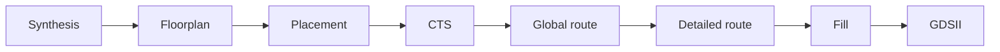

<div align="center">

# 📘 Week 4 · Phase 4 — Run the RTL-to-GDS Flow
### Does the whole flow run from RTL to GDSII, and does timing pass at 100 MHz?

    

**Author:** Mysha Fathima · **Period:** 23 November 2026 · **Tools:** ORFS, OpenROAD 26Q4-2390, Yosys 0.71 · **Platform:** sky130hd

[← Phase 3](../Phase3-clock-constraint/README.md) · [Phase 5 →](../Phase5-gate-level-outputs/README.md)

</div>

---

## 🎯 Goal
Run every stage from synthesis to GDSII and capture proof for each.

## 🧭 Stages



I ran the flow twice. In the first run (GitHub Codespace) synthesis, floorplan, placement and CTS passed, but global route failed. After the Codespace quota ended I redid everything locally with the corrected config, and that run completed.

## ▶️ Commands (final local run)

```bash
export YOSYS_EXE=$HOME/tools/oss-cad-suite/bin/yosys
export OPENROAD_EXE=$HOME/OpenROAD-flow-scripts/tools/install/OpenROAD/bin/openroad
cd ~/OpenROAD-flow-scripts/flow
make DESIGN_CONFIG=./designs/sky130hd/user_project_wrapper/config.mk synth
make DESIGN_CONFIG=./designs/sky130hd/user_project_wrapper/config.mk
```

`make` follows the ORFS recipe. The first command runs only synthesis, the second runs everything after it. (The GDS step needed one more fix, see Phase 6.)

## 1️⃣ Synthesis
Yosys turned the Verilog into a gate netlist in about 2 seconds. Design area after synthesis: 5,901 µm².

📸 **SS 4.1 — synthesis success**


## 2️⃣ Floorplan, 3️⃣ Placement, 4️⃣ CTS
These stages wrote `2_floorplan.odb`, `3_place.odb` and `4_cts.odb` (62 MB each).

📸 **SS 4.2 — `results` listing with the three `.odb` files**


## 5️⃣ Routing, 6️⃣ Fill, 7️⃣ Final database and GDS
Global route and detailed route passed with no RSZ-0074 error. Fill insertion added 1,216,315 fill cells. The flow ended by writing `6_final.gds` (144 MB).

📸 **SS 4.3 — flow summary table (all stages with `.odb` and `.sdc`)**


📸 **SS 4.4 — cell type report (fill, tap, clock buffers)**


## ⏱️ Time per stage

| Stage | Result file | Seconds |
|---|---|---|
| Synthesis | `1_2_yosys.v`, `1_synth.odb` | 2 |
| Floorplan (tapcell, PDN) | `2_floorplan.odb` | 14 |
| Placement | `3_place.odb` | 397 |
| CTS | `4_cts.odb` | 15 |
| Global route | `5_1_grt.odb` | 41 |
| Detailed route | `5_2_route.odb` | 133 |
| Fill | `5_3_fillcell.odb`, `6_1_fill.odb` | 40 |
| GDS merge | `6_1_merged.gds` → `6_final.gds` | 25 |
| Final report | `6_finish.rpt` | 738 |
| **Total** | | **1406 (about 23 min)** |

## 📈 Final timing and design statistics

| Check | Value |
|---|---|
| WNS / TNS | 0.00 / 0.00 |
| Worst setup slack | **7.94 ns (MET)** at a 10 ns clock |
| Hold-side slack | 0.49 ns (MET) |
| Design area | 175,204 µm² (2 % utilisation) |
| Cells | 1,352,194 total (fill 1,216,315, tap 135,240) |
| Flip-flops (sequential) | 97 |
| Clock buffers / inverters | 10 / 6 |
| Timing repair buffers | 114 |
| Worst IR drop (VSS) | 1.03e-04 V (0.01 %) |

📸 **SS 4.6 — final timing (`6_finish.rpt`: WNS, TNS, slack)**


## 🧾 Proof required by the task

| Proof | Where |
|---|---|
| Synthesis report | `synth_stat.txt`, `local_synth.log` |
| Floorplan completion | `2_floorplan.odb`, `2_floorplan_final.rpt` |
| Placement completion | `3_place.odb`, `3_detailed_place.rpt` |
| CTS execution | `4_cts.odb`, `4_cts_final.rpt` |
| Routing completion | `5_2_route.odb`, `5_route_drc.rpt` |
| Fill insertion | `6_1_fill.odb`, 1,216,315 fill cells |
| Final GDS | `6_final.gds` |
| Final timing report | `6_finish.rpt` |

## 🛠️ Issues and solutions
Global route error (first run) and the klayout error at the GDS step. Both are explained in [Phase 6](../Phase6-debugging/README.md).

## ✅ Completion checklist
- [x] Synthesis
- [x] Floorplan
- [x] Placement
- [x] CTS
- [x] Routing
- [x] Fill
- [x] Final database
- [x] Final GDS
- [x] Final timing report

## 🗃️ Evidence
[`evidence/local_synth.log`](evidence/local_synth.log) · [`evidence/local_full_flow.log`](evidence/local_full_flow.log) · [`evidence/local_full_flow_gds.log`](evidence/local_full_flow_gds.log) · Codespace logs: [`1_synth_console.log`](evidence/1_synth_console.log), [`full_flow_console.log`](evidence/full_flow_console.log)

## 💡 What I learned
Every stage writes its own database, so progress is easy to check. The summary table at the end shows quickly whether a stage was skipped.

## 📝 Summary of this phase
The full flow now runs from synthesis to GDSII in about 23 minutes on my laptop. Timing is met at 100 MHz: setup slack is 7.94 ns and hold slack is 0.49 ns, with zero negative slack. The first run in Codespaces failed at global route, and the final run completed after the fix described in Phase 6. Every stage left its own database and report, which I use as proof.
